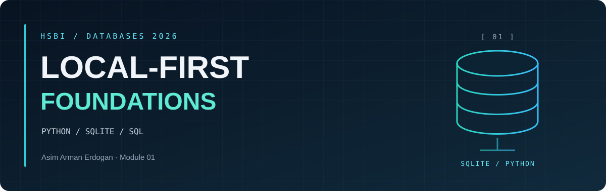
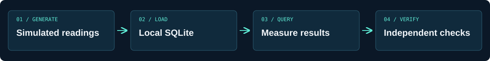
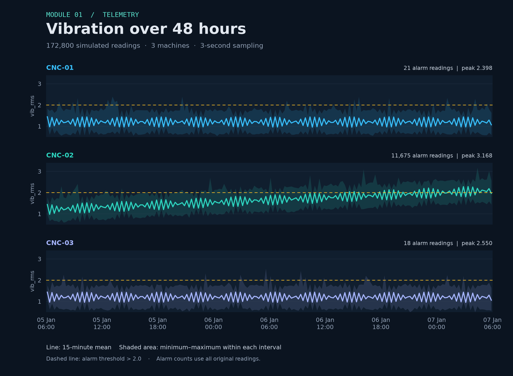

<p align="center"><sub>DATABASES 2026 &nbsp; / &nbsp; MODULE 01 &nbsp; / &nbsp; OVERVIEW</sub></p>

<h1 align="center">Introduction and <em>Local-First</em> Foundations</h1>

<table align="center">
<tr>
<td align="center"><strong>172,800</strong><br><sub>SIMULATED READINGS</sub></td>
<td align="center"><strong>3</strong><br><sub>CNC MACHINES</sub></td>
<td align="center"><strong>10,526,720 B</strong><br><sub>RECORDED DATABASE SIZE</sub></td>
<td align="center"><strong>Local SQLite</strong><br><sub>NO DATABASE SERVER</sub></td>
</tr>
</table>

<p align="center">
<a href="#learning-goals">Learning goals</a> &nbsp; · &nbsp;
<a href="audit.md">Evidence index</a> &nbsp; · &nbsp;
<a href="telemetry-results.md">Measurements</a> &nbsp; · &nbsp;
<a href="ai-sql-verification.md">SQL verification</a>
</tr>

**Creator:** Asim Arman Erdogan.
</p>

---

</tr>


**Exploration plan:** generate *machine telemetry*, measure local `SQLite` queries, and **independently verify** an AI-generated time-filtered aggregate.
</tr>

<a id="learning-goals"></a>

<h2 align="center">◈ <code>01</code> / Learning goals</h2>

1. Explain how this class works - the **CBL/PBL philosophy**, the *portfolio-based project work assessment*, and the "moving bar" of a first-time course.
2. Set up your **personal GitHub portfolio** from the course template, with a clean first commit and a `.gitignore` that keeps databases and secrets out of Git.
3. Set up the entire toolchain **reproducibly** with `uv` - one fixed Python plus SQLite, DuckDB, Datasette, and more - on Windows, macOS, or Linux, and verify it.
4. Explain - *with a measurement, not a slide* - the difference between an **embedded database** and a **client/server database**, and why most local apps should not run a server.
5. Load real rows into SQLite and query them from Python using **bound parameters**.
6. Take a first LLM-generated query, run it, and begin the habit that defines this course: **verify before you trust**.

<a id="course-and-evidence-links"></a>

<h2 align="center">◈ <code>02</code> / Course and evidence links</h2>

- [Module instructions](https://github.com/iotempire/iotempire-teaching/blob/main/full-classes/hsbi-databases-10d/modules/01-introduction-and-local-first.md)
- [Syllabus](https://github.com/iotempire/iotempire-teaching/blob/main/full-classes/hsbi-databases-10d/syllabus.md)
- [Reflection](../Reflections/ref01.md)
- [SQL Island - guided completion and certificate](sql-island.md)
- [Learning-goal evidence audit](audit.md)
- [Pod mate: Habiba Darwish](https://github.com/Habiba-AladdinDarwish/Darwish_Databases_C2026) (private portfolio).

Run commands from the **repository root**. Technical evidence is indexed below.

<a id="course-model"></a>

<h2 align="center">◈ <code>03</code> / Course model</h2>

**Learning goals** define the contract. Challenge- and project-based learning uses practical problems and portfolio evidence; assessment includes module points, a final project and reflections. The course is a first iteration, so task wording can evolve while learning goals remain the basis for assessment. A pod contains two or three students; two pods form the final project team.

<a id="embedded-versus-clientserver"></a>

<h2 align="center">◈ <code>04</code> / Embedded versus client/server</h2>

**SQLite** executes *inside the Python process* and stores data in a **local file**. This experiment holds **172,800 readings** in **10,526,720 bytes**; measured query times are recorded in the linked telemetry results. No database server was needed. This proves the local workload runs without a server; it *does not benchmark a remote database*.

An embedded database simplifies deployment and offline operation, but SQLite permits **only one writer at a time**. A client/server database supports **shared network access** and **many concurrent writers**, with server administration and network dependencies. A server becomes appropriate when those workload requirements justify it.

<a id="participation-and-attribution"></a>

<h2 align="center">◈ <code>05</code> / Participation and attribution</h2>

I worked with Habiba and three other classmates over the weekend. My [reflection](../Reflections/ref01.md) describes that experience. See [collaboration notes](../COLLABORATION.md) for the portfolio review and how AI was used.

<a id="task-3-reproducible-toolchain"></a>

<h2 align="center">◈ <code>06</code> / Task 3: Reproducible toolchain</h2>

Run from the **repository root**:

```bash
uv run python Module01-Restyle/uv-check.py
```

- [Verification script](uv-check.py)
- [Recorded version output](uv-check-output.txt)
- [Project dependencies](../pyproject.toml)
- [Locked dependencies](../uv.lock)

<a id="task-4-sqlite-shell-tour"></a>

<h2 align="center">◈ <code>07</code> / Task 4: SQLite shell tour</h2>

- [Replayable shell commands](tour-commands.sql)
- [Captured session, including query timing](shell-tour.txt)
- [Schema and data dump](tour.sql)

Replay from the repository root with `sqlite3 -echo Module01-Restyle/tour.db ".read Module01-Restyle/tour-commands.sql"`.
The local database is excluded from Git by `.gitignore`.

*AI-assisted observation:* `.schema` was useful because it displayed the exact table definition and column types before querying.

<a id="task-5-sql-island"></a>

<h2 align="center">◈ <code>08</code> / Task 5: SQL Island</h2>

[Completed guided demonstration](sql-island.md), with the original certificate, completion screenshot and SQL examples. I watched the assistant enter and explain the queries, and added my answers below the game notes.

<a id="task-6-telemetry-pipeline"></a>

<h2 align="center">◈ <code>09</code> / Task 6: Telemetry pipeline</h2>

- [Generator](generate_telemetry.py)
- [SQLite loader](load_telemetry.py)
- [Three SQL queries](queries.sql)
- [Results, timings, database size and row count](telemetry-results.md)



Generated CSV and database files **stay local** and can be reproduced from the scripts.



*Simulated telemetry, 5–7 January 2026. Lines show 15-minute averages; shaded bands retain the minimum and maximum in each interval.* [Measurements and chart details](telemetry-results.md#vibration-chart).

<a id="task-7-ai-assisted-sql-verification"></a>

<h2 align="center">◈ <code>10</code> / Task 7: AI-assisted SQL verification</h2>

- [Generated query](overnight.sql)
- [Prompt, execution, query plan and verification report](ai-sql-verification.md)
- [Reproducible verification script](verify_telemetry.py)

*Implementation and evidence were prepared with AI assistance.* Review the **time-boundary interpretation** in the verification report.

---

<p align="center"><sub>MODULE 01 &nbsp; / &nbsp; LOCAL-FIRST FOUNDATIONS</sub><br><a href="README.md">Module overview</a> &nbsp; · &nbsp; <a href="audit.md">Evidence index</a> &nbsp; · &nbsp; <a href="../README.md">Portfolio</a></p>
