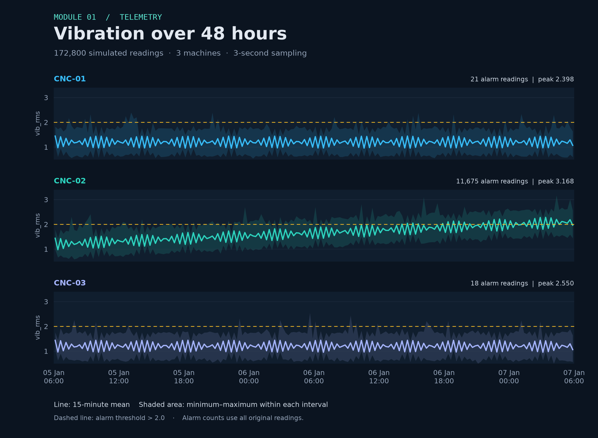

<p align="center"><sub>DATABASES 2026 &nbsp; / &nbsp; MODULE 01 &nbsp; / &nbsp; TELEMETRY / TASK 06</sub></p>

# Synthetic telemetry in SQLite

The course generator creates **repeatable simulated readings** using a *fixed random seed*.

| Recorded dataset | Value |
| :--- | ---: |
| Database size | **10,526,720 bytes** |
| Row count | **172,800** |

The database is **embedded in a local file**; *no database server was started*.

<a id="vibration-chart"></a>

## Vibration over time



The chart uses the **172,800 simulated readings** recreated by [the module generator](generate_telemetry.py), with its fixed seed of `42`.

- **Solid lines:** 15-minute averages of `vib_rms`.
- **Shaded bands:** the minimum and maximum within each interval, including brief spikes.
- **Dashed line:** the boundary for the SQL alarm condition, `vib_rms > 2.0`.
- **Counts and peaks:** calculated from all original readings, before aggregation; they match the SQL results below.

**CNC-02 accounts for 11,675 of the 11,714 alarm readings.** Its rising baseline is deliberately built into the simulation. These are simulated signals, not measurements from physical machines. The dataset does not specify a physical unit for `vib_rms`.

<details>
<summary>Recreate the chart</summary>

Run from the repository root:

```bash
uv run --no-project --script Module01-Restyle/plot_telemetry.py
```

The [plotting script](plot_telemetry.py) generates the CSV if needed, checks the row count, alarm total and all three peaks against the recorded results, then writes PNG and SVG versions to `assets/`. It does not rerun or overwrite the SQL reports.

</details>

## SQL results

### 01 / Readings per machine

```sql
SELECT machine, COUNT(*) AS n FROM readings GROUP BY machine;
```
| machine | n |
| --- | --- |
| cnc-01 | 57600 |
| cnc-02 | 57600 |
| cnc-03 | 57600 |
Wall-clock execute + fetch time: **45.726 ms** *(one run)*.

### 02 / Peak vibration

```sql
SELECT machine, MAX(vib_rms) AS peak_vib FROM readings GROUP BY machine;
```
| machine | peak_vib |
| --- | --- |
| cnc-01 | 2.398 |
| cnc-02 | 3.168 |
| cnc-03 | 2.55 |
Wall-clock execute + fetch time: **52.032 ms** *(one run)*.

### 03 / Alarm readings

```sql
SELECT COUNT(*) AS alarm_readings FROM readings WHERE vib_rms > 2.0;
```
| alarm_readings |
| --- |
| 11714 |
Wall-clock execute + fetch time: **13.338 ms** *(one run)*.

> **Measurement note** — Times are machine-dependent observations, not a benchmark.

**Cloud cost:** this local run has no cloud-service charge; a hosted version would depend on the provider, resources, storage and traffic, with charges paid by the cloud account owner.

Reproduce from the **repository root**:
```text
uv run python Module01-Restyle/generate_telemetry.py
uv run python Module01-Restyle/load_telemetry.py
uv run python Module01-Restyle/verify_telemetry.py
```

---

<p align="center"><sub>MODULE 01 &nbsp; / &nbsp; LOCAL-FIRST FOUNDATIONS</sub><br><a href="README.md">Module overview</a> &nbsp; · &nbsp; <a href="audit.md">Evidence index</a> &nbsp; · &nbsp; <a href="../README.md">Portfolio</a></p>
