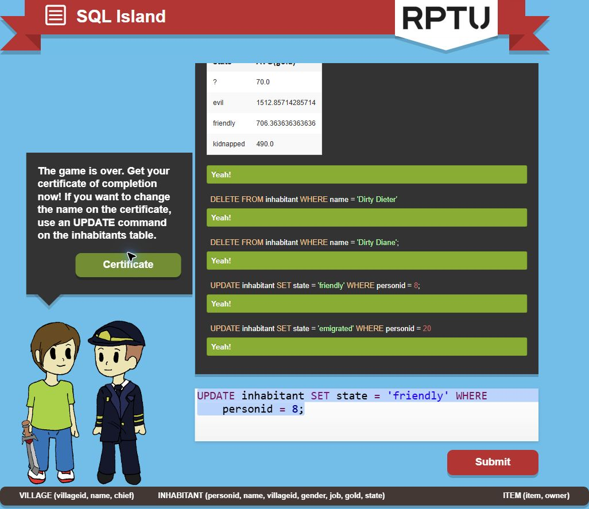

# SQL Island — completed guided demonstration

Completed on 2026-10-28 in the English version, using the character name Asim. The final screen confirmed that the game was over after the pilot was released and the character left the island.

## Completion evidence

- [Original completion certificate (PDF)](evidence/Certificate_SQL-Island.pdf) — supplied by the student, unchanged.
- [Completion screenshot](evidence/sql-island-completed.jpg).

## How the session was completed

The student requested an explanatory demonstration and watched while the AI assistant entered the queries and explained each step in Turkish. Some statements were run automatically by the game as teaching examples. This records a completed guided session, not independent gameplay or an unaided assessment of the student's SQL knowledge. The certificate records the game's completion; this note records the assistance used.

## Commands and patterns demonstrated

| Concept | Example from the session | What it does |
| --- | --- | --- |
| Read a table | `SELECT * FROM inhabitant;` | Shows all inhabitants and columns. |
| Select a column and filter rows | `SELECT personid FROM inhabitant WHERE name = 'Stranger';` | Returned character ID 20. SELECT chooses columns; WHERE chooses rows. |
| Combine conditions | `WHERE state = 'friendly' AND (job = 'dealer' OR job = 'merchant')` | Finds friendly people with either job. Parentheses preserve the intended grouping. |
| Match a pattern | `WHERE state = 'friendly' AND job LIKE '%smith'` | Finds friendly workers whose job ends in smith. |
| Find missing owners | `SELECT * FROM item WHERE owner IS NULL;` | Finds ownerless items. NULL is tested with IS NULL, not = NULL. |
| Change selected records | `UPDATE item SET owner = 20 WHERE owner IS NULL;` | Assigns only ownerless items to the character. |
| Sort | `SELECT * FROM inhabitant WHERE job = 'baker' ORDER BY gold DESC;` | Lists bakers from richest to poorest. |
| Combine related tables | `SELECT i.name FROM village AS v JOIN inhabitant AS i ON v.chief = i.personid WHERE v.name = 'Onionville';` | Matches the chief ID to a person ID; returned Fred Dix. |
| Count rows | `SELECT COUNT(*) FROM inhabitant WHERE villageid = 3;` | The equivalent game example joined by village name and counted 8 inhabitants. |
| Sum selected values | `SELECT SUM(gold) FROM inhabitant WHERE job IN ('baker', 'dealer', 'merchant');` | Returned 4130 gold for those jobs. |
| Group and average | `SELECT state, AVG(gold) FROM inhabitant GROUP BY state;` | Returns one average for each state rather than one row for each person. |
| Add a record | `INSERT INTO item (item, owner) VALUES ('sword', 20);` | The game automatically added the sword. |
| Delete a selected record | `DELETE FROM inhabitant WHERE name = 'Dirty Diane';` | Removes that fictional character's row. Omitting WHERE would affect the whole table. |
| Release the pilot | `UPDATE inhabitant SET state = 'friendly' WHERE personid = 8;` | Changes Arthur Tailor's state, allowing the story to finish. |

## Verification and a correction during play

The editor initially retained an earlier SELECT when the friendly-person query was entered. The result still contained evil characters, so it did not meet the intended filter. The assistant cleared the editor, ran only the filtered statement and confirmed friendly results. A successful execution alone did not establish that the intended query had run.

The inventory query confirmed six items with owner 20 after collecting ownerless items. Results identified the pilot as Arthur Tailor, personid 8, initially kidnapped. After the release UPDATE, the game advanced to the departure and completion screens.

## Four personal questions — student answers pending

The technical notes above summarize the demonstration; they do not answer these questions on the student's behalf.

1. **What did you learn about databases and SQL from the game alone?**
   Student answer pending.
2. **Which SQL commands and patterns did you actually use?**
   Student answer pending. Distinguish watching the assistant from personally entering queries.
3. **In your own words, what are a table, a row, a column and a query?**
   Student answer pending.
4. **What surprised you and what is still confusing?**
   Student answer pending.

[Game](https://sql-island.informatik.uni-kl.de/) · [Module instructions](https://github.com/iotempire/iotempire-teaching/blob/main/full-classes/hsbi-databases-10d/modules/01-introduction-and-local-first.md)
