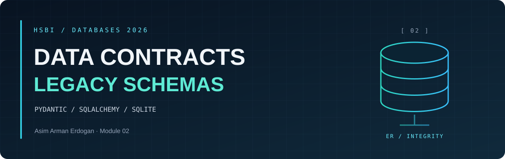
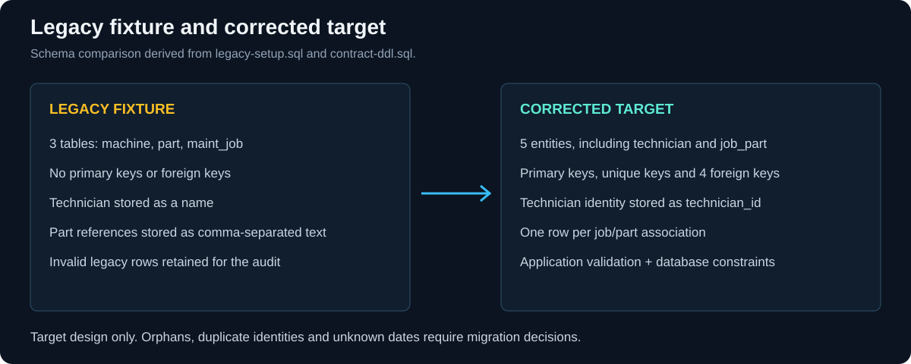

<p align="center"><sub>DATABASES 2026 &nbsp; / &nbsp; MODULE 02 &nbsp; / &nbsp; OVERVIEW</sub></p>

<h1 align="center">Data Contracts and <em>Legacy Schema Audit</em></h1>

<table align="center">
<tr>
<td align="center"><strong>3</strong><br><sub>LEGACY TABLES</sub></td>
<td align="center"><strong>4</strong><br><sub>MAINTENANCE JOBS</sub></td>
<td align="center"><strong>5</strong><br><sub>DEFECT CATEGORIES</sub></td>
<td align="center"><strong>5</strong><br><sub>TARGET ENTITIES</sub></td>
</tr>
</table>

<p align="center"><a href="#learning-goals">Learning goals</a> &nbsp; · &nbsp; <a href="er-audit.md">ER audit</a> &nbsp; · &nbsp; <a href="defect-results.md">Integrity results</a> &nbsp; · &nbsp; <a href="contract-notes.md">Contract</a></p>

**Creator:** Asim Arman Erdogan.

---

[Course module](https://github.com/iotempire/iotempire-teaching/blob/main/full-classes/hsbi-databases-10d/modules/02-data-contracts-and-legacy-schemas.md) · [Portfolio](../README.md)

<a id="learning-goals"></a>

<h2 align="center">◈ <code>01</code> / Learning goals</h2>

1. Reconstruct an **ER/EER model** from an undocumented SQL schema.
2. Identify **integrity defects** with queries.
3. Distinguish entities, relationships, attributes, surrogate keys and natural keys.
4. Express a corrected schema as a code-first **Pydantic / SQLAlchemy contract**.
5. Write the business requirements the original schema omitted.

<a id="task-status"></a>

<h2 align="center">◈ <code>02</code> / Task status</h2>

| Task | Evidence | Status |
| --- | --- | --- |
| A - Study | [Study log](study-log.md), two attributed example redraws and verified Q&A | References, examples and query checks recorded |
| B - Four sketches | [ER examples and proof](er-examples.md), [SQL](cardinality.sql) | Completed with AI assistance and executed proof |
| C - Explain and share | [Collaboration record](../COLLABORATION.md), agreed-learning section in study log | Key discussion, shared diagram and Discord link recorded |
| Setup | [Fixture](legacy-setup.sql) | Fixed: legacy.db was SQL text, now rebuilt as a real SQLite database |
| 1 - ER reconstruction | [ER audit](er-audit.md), [counts](cardinality-results.md) | Completed and checked |
| 2 - Integrity defects | [Queries](defect-queries.sql), [results and impact](defect-results.md) | All five demonstrated |
| 3 - Code contract | [Python](contract.py), [DDL](contract-ddl.sql), [decisions](contract-notes.md), [checks](verification.txt) | Built and checked with negative tests |
| Reflection | [Reflection 2](../Reflections/ref02.md) | Completed |



*The legacy fixture remains available for the audit. The five-entity contract is a target schema, not an automatic migration.* [Model and requirements](er-audit.md) · [Enforcement decisions](contract-notes.md).

These files cover the core technical tasks. The optional inheritance and extra Mermaid exercises are not included.

<a id="reproduce"></a>

<h2 align="center">◈ <code>03</code> / Reproduce</h2>

From the **portfolio root**:

```sh
uv run --locked python Module02-Restyle/verify_module02.py
uv run --locked python Module02-Restyle/contract.py
```

The verifier rebuilds the three lab tables, updates the reports and checks the corrected schema in a separate in-memory database. If legacy.db contains SQL text instead of a database, it keeps a backup before rebuilding it. Database files **stay local**.

The repaired contract is a **target schema**. The original orphan job, duplicate part and unknown installation date need explicit decisions before migration; they are **not silently discarded or invented**.

<details>
<summary>Recreate the module visuals</summary>

```sh
uv run --no-project --script Module02-Restyle/render_visuals.py
uv run --no-project --script Module02-Restyle/render_diagrams.py
```

The overview visuals are checked against the local fixture and contract DDL. ER visuals use the Mermaid sources retained in each document. The copied verifier preserves the presentation of its generated reports.

</details>

---

<p align="center"><sub>MODULE 02 &nbsp; / &nbsp; DATA CONTRACTS AND LEGACY SCHEMAS</sub><br><a href="README.md">Module overview</a> &nbsp; · &nbsp; <a href="er-audit.md">ER audit</a> &nbsp; · &nbsp; <a href="../README.md">Portfolio</a></p>
