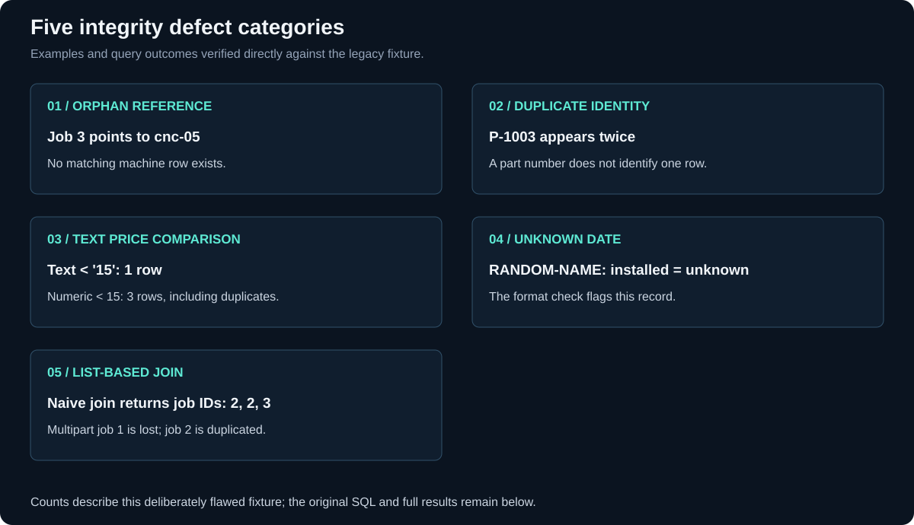

<p align="center"><sub>DATABASES 2026 &nbsp; / &nbsp; MODULE 02 &nbsp; / &nbsp; INTEGRITY RESULTS</sub></p>

<h1 align="center">Integrity defects — actual query results</h1>



*The diagram summarizes the same fixture and queries documented below. A numeric cast repairs this comparison, not arbitrary price validation.*

Each query below checks a problem in the sample data. The SQL comments explain what could go wrong in use.

### 01 / Orphan job

```sql
-- 1. Orphan job: cannot be assigned to a real machine/site.
SELECT j.job_id, j.machine_name FROM maint_job j
LEFT JOIN machine m ON m.machine_name=j.machine_name WHERE m.machine_name IS NULL;
```
| job_id | machine_name |
| --- | --- |
| 3 | cnc-05 |

Measured execute + fetch: **0.214 ms** *(one local run)*.

### 02 / Duplicate part identity

```sql
-- 2. Duplicate part key: ambiguous identity and duplicated join results.
SELECT part_no, COUNT(*) AS copies FROM part GROUP BY part_no HAVING COUNT(*)>1;
```
| part_no | copies |
| --- | --- |
| P-1003 | 2 |

Measured execute + fetch: **0.092 ms** *(one local run)*.

### 03a / Text price comparison

```sql
-- 3. Text comparison omits the 9.90 parts: wrong purchasing/invoice decisions.
SELECT part_no, unit_price FROM part WHERE unit_price < '15';
```
| part_no | unit_price |
| --- | --- |
| P-1001 | 12.50 |

Measured execute + fetch: **0.052 ms** *(one local run)*.

### 03b / Numeric comparison

```sql
SELECT part_no, unit_price FROM part WHERE CAST(unit_price AS NUMERIC) < 15;
```
| part_no | unit_price |
| --- | --- |
| P-1001 | 12.50 |
| P-1003 | 9.90 |
| P-1003 | 9.90 |

Measured execute + fetch: **0.063 ms** *(one local run)*.

### 04 / Unknown installation date

```sql
-- 4. Unknown installation date: age-based maintenance cannot be scheduled.
-- This detects format defects only, not all impossible calendar dates.
SELECT machine_name, installed FROM machine
WHERE installed IS NULL OR installed NOT GLOB '[0-9][0-9][0-9][0-9]-[0-9][0-9]-[0-9][0-9]';
```
| machine_name | installed |
| --- | --- |
| RANDOM-NAME | unknown |

Measured execute + fetch: **0.060 ms** *(one local run)*.

### 05 / List-based join

```sql
-- 5. List equality loses multipart job 1 and duplicates job 2.
SELECT j.job_id, p.description FROM maint_job j JOIN part p ON p.part_no=j.parts_used;
```
| job_id | description |
| --- | --- |
| 2 | Coolant filter |
| 2 | Coolant filter |
| 3 | Ball bearing 6203 |

Measured execute + fetch: **0.070 ms** *(one local run)*.

The naive list join returns job 2 twice because P-1003 is duplicated; job 1 is absent. CAST repairs this fixture's comparison but is not general validation of arbitrary text prices.

---

<p align="center"><sub>MODULE 02 &nbsp; / &nbsp; DATA CONTRACTS AND LEGACY SCHEMAS</sub><br><a href="README.md">Module overview</a> &nbsp; · &nbsp; <a href="er-audit.md">ER audit</a> &nbsp; · &nbsp; <a href="../README.md">Portfolio</a></p>
