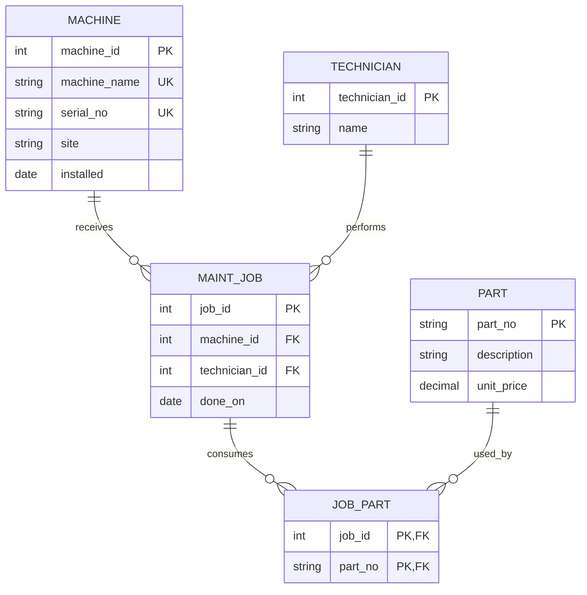

# Task 1 — Legacy ER audit

The legacy fixture declares **no primary keys, unique constraints or foreign keys**. The following is reconstructed intent, not existing enforcement.

| Intended entity | Attributes | Intended identifier |
| --- | --- | --- |
| Machine | machine_name, serial_no, site, installed | surrogate machine_id; serial_no UNIQUE; machine_name unique by explicit plant assumption |
| Part | part_no, description, unit_price | natural part_no, currently duplicated |
| MaintenanceJob | job_id, machine reference, technician reference, done_on | job_id |
| Technician | technician_id, name | surrogate technician_id; name is not unique |
| JobPart | job reference, part reference | composite (job_id, part_no) |

## Reconstructed intended model

[Actual count queries and results](cardinality-results.md) show two jobs for cnc-01 and two for Beier; one job has two part tokens; P-1001 occurs in two different jobs. These exhibit 1:n and m:n instances. Job 3 references missing cnc-05, and duplicate part P-1003 makes identity ambiguous. Neither defect is a legitimate relationship.

- **1:1:** no separate 1:1 relationship is represented or proven by the legacy data; serial_no is currently an attribute, with intended uniqueness still unenforced.
- **1:n:** machine-to-job and technician-to-job are suggested by repeated names, but references and mandatory participation are not enforced.
- **m:n:** job-to-part is hidden in the comma-separated parts_used column; JobPart makes it explicit and prevents repeated pairs.

The count expression handles NULL/empty lists as zero. It is suitable for this controlled fixture; arbitrary CSV text needs a real parsing policy. Counts reveal sample multiplicities, while constraints specify allowed future data.

## Requirements the schema forgot

1. Every job must reference one existing machine and one existing technician.
2. A machine serial is required, begins SN-, and is unique; names are mutable labels. This plant additionally assumes machine_name is unique.
3. Part numbers identify one part; prices must be nonnegative, at most 9,999,999.99 and have at most two decimal places.
4. Installation and completion dates must be valid calendar dates. “unknown” needs a documented missing-data decision, not an invented date.
5. Each job/part pair can occur once. A job may use no parts (as job 4 does).
6. Referenced machines, technicians and parts cannot be deleted while jobs still reference them.
7. Legacy names cannot safely identify technicians during migration without human identity confirmation.

No automatic data migration is claimed: quarantine cnc-05/unknown dates, resolve duplicated part identities and verify technician mappings before importing into the corrected schema.
