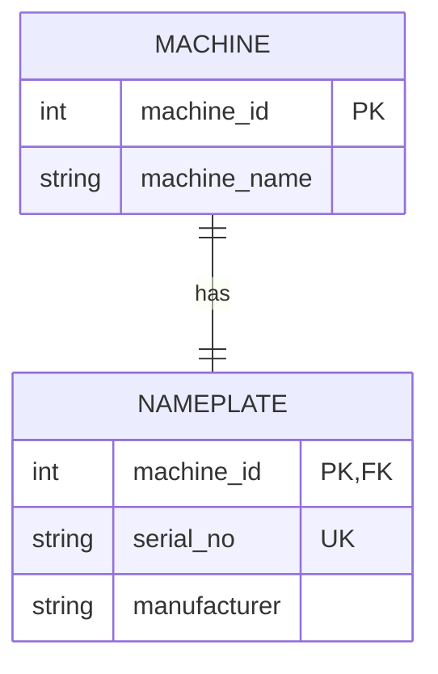
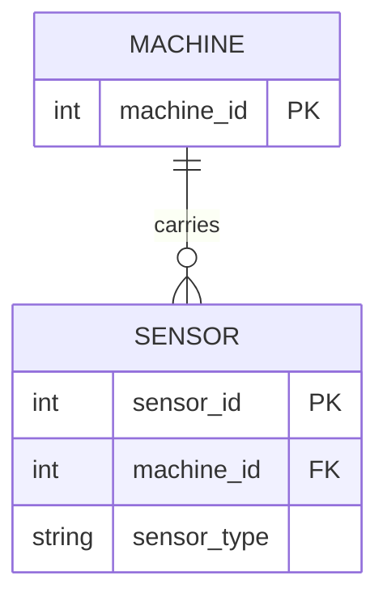
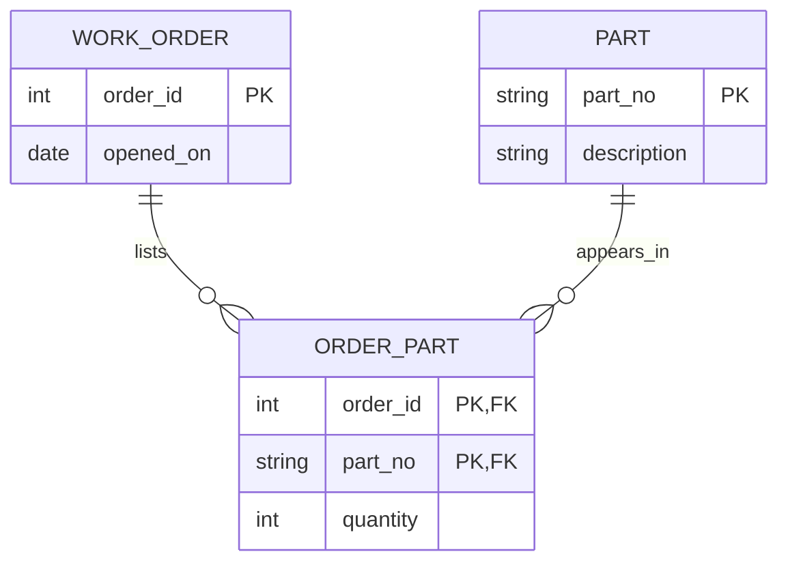
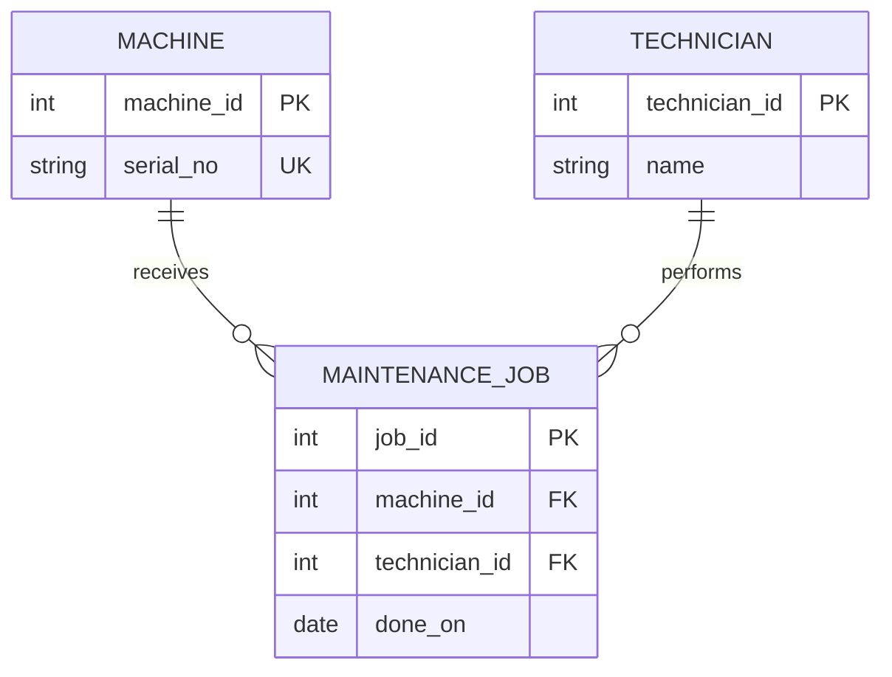

# Task B - Four workshop ER sketches

AI-assisted models. Lower bounds are explicit assumptions where the story says “many” without specifying a minimum.

## 1. Machine and nameplate - exactly 1:1

A shared primary/foreign key enforces at most one nameplate per machine and exactly one existing machine per nameplate. It does **not** require every machine to have a nameplate. To enforce both mandatory sides without cyclic insertion or triggers, I would store required `serial_no UNIQUE NOT NULL` and `manufacturer NOT NULL` on Machine. A separate entity is justified only if the nameplate has an independent lifecycle; then total participation needs an explicit transaction/workflow or database enforcement. The diagram describes the business rule, not what a lone FK guarantees.

## 2. Machine and sensors - 1:n

The foreign key is on Sensor and is NOT NULL. Each sensor belongs to exactly one machine; a machine can have zero or many sensors. Zero is a stated allowance for machines awaiting installation. If “many” means at least one, an additional parent-side rule is needed.

### Executable CREATE TABLE + COUNT proof

Run [cardinality.sql](cardinality.sql) against a fresh SQLite database, or run the verifier. It creates one machine and inserts **two sensor rows**. The query `SELECT machine_id, COUNT(*) AS sensors FROM sensor GROUP BY machine_id;` returns:

| machine_id | sensors |
| --- | --- |
| 1 | 2 |

The verifier also inserts an orphan sensor deliberately and confirms a foreign-key error. The counts exhibit 1:n; the NOT NULL FK enforces the child-to-parent rule. They do not prove that every machine must have a sensor.

## 3. Work orders and parts - m:n

The junction key is `(order_id, part_no)`: an order cannot list the same part twice. Quantity belongs to the association, with a positive-value rule. Zero parts is allowed for a new order; mandatory consumption would require another rule.

## 4. Maintenance job, machine and technician

A job is an event entity: its identity, date and part associations justify a separate record. Technician is an entity because people have identity independent of their names, and one person performs many jobs. Two technicians may share a name. Date is a job attribute, not a separate entity in this scope. Both job references are mandatory; machines and technicians can exist before any job.
