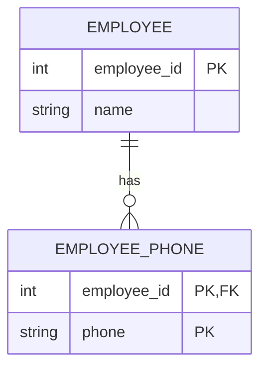
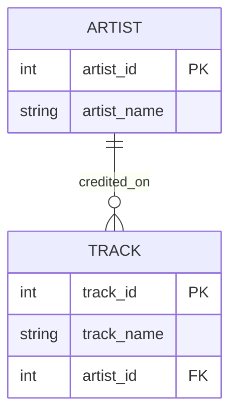
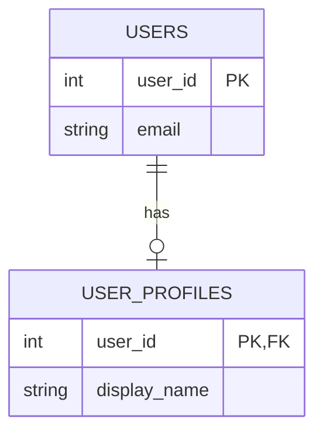
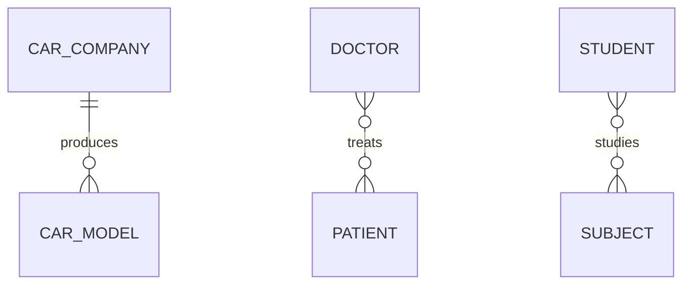

# Module 02 study log

These notes bring together the references, diagrams and query checks for Module 2. They were prepared with AI assistance and updated after checking the full module tasks.

## 1. References used

| Source | Concept clarified |
| --- | --- |
| Adrienne Watt, [Database Design, 2nd edition, Chapter 8](https://opentextbc.ca/dbdesign01/chapter/chapter-8-entity-relationship-model/) | A multivalued phone attribute can become a separate EmployeePhone entity. |
| SQLite, [Foreign Key Support](https://www.sqlite.org/foreignkeys.html) | A child reference must match a parent key; use NOT NULL when the relationship is mandatory. Enable foreign keys for each connection. |
| SQLite, [CREATE TABLE](https://www.sqlite.org/lang_createtable.html) | PRIMARY KEY, UNIQUE and NOT NULL are enforceable rules, including composite keys. |

## 2. Web searches performed by the assistant

- `site.opentextbc.ca dbdesign entity relationship model weak entity employee dependent` - found the textbook's entity/attribute examples and EmployeePhone model; [source](https://opentextbc.ca/dbdesign01/chapter/chapter-8-entity-relationship-model/).
- `site.sqlite.org foreignkeys CREATE TABLE UNIQUE composite primary key` - found official constraint and foreign-key documentation; [source](https://www.sqlite.org/foreignkeys.html), [CREATE TABLE](https://www.sqlite.org/lang_createtable.html).

These searches were carried out with AI assistance.

## 3. Technical observations and counterexamples

- A plausible key name is not a uniqueness rule: an in-memory SQLite table with `part_no TEXT` accepted `P-1003` twice. A duplicate-count query returned `P-1003 | 2`.
- In a local machine/sensor experiment, two sensors referenced machine 1. Inserting a sensor for machine 99 failed with `FOREIGN KEY constraint failed` after enabling foreign keys.
- Row counts demonstrate an example instance; constraints express which future instances are allowed. Two sample rows alone do not prove a schema enforces cardinality.
- “Exactly one” needs both minimum and maximum participation. A unique child reference limits children per parent, but does not ensure every parent has a child.

## 4. LLM Q&A

These questions helped structure the AI-assisted explanations and checks.

### Prompt: Which table holds the foreign key in a machine-to-sensor 1:n relationship?

Answer: Put machine_id on Sensor. A NOT NULL foreign key makes every sensor refer to one existing machine; it permits several sensors to share a machine.

Verification: The in-memory experiment inserted two sensors referencing machine 1 and rejected a reference to missing machine 99. This does not force every machine to have a sensor.

### Prompt: Is a column named part_no automatically a key?

Answer: No. The intended identifier needs an enforced uniqueness rule and, for a required identifier, NOT NULL. A column name has no constraint semantics.

Verification: The duplicate P-1003 insert succeeded without constraints. The rule is documented in SQLite CREATE TABLE. No contradiction was found in this check.

### Prompt: Does a UNIQUE foreign key enforce exactly one child for every parent?

Answer: No. It prevents two children sharing the same non-null parent reference. It does not require each parent to be referenced.

Verification: In the one-to-many experiment, a foreign key limited child references but did not impose a parent-side minimum. Official SQLite documentation defines a child-to-parent existence check; full 1:1 total participation needs an additional design decision or enforcement mechanism. The four sketches and executable proof are in [er-examples.md](er-examples.md).

## 5. Two selected found examples, redrawn

These two examples were selected with AI assistance and redrawn in Mermaid. The notes explain the assumptions about whether a relationship is optional or required.

### Example A: Employee and multiple phone numbers

Source: Watt, Chapter 8, “Characteristic entities”, EmployeePhone example. Credit: Adrienne Watt / BCcampus; chapter credits include Nguyen Kim Anh. See the [source and its licence/attribution](https://opentextbc.ca/dbdesign01/chapter/chapter-8-entity-relationship-model/).

Lesson from this example: an owner's key can also be part of a child's composite identifier. A phone-number list becomes individual records. Assumption: an employee may have zero phone numbers; each phone record belongs to exactly one employee.

### Example B: Artist and tracks

Source: SQLite's [foreign-key tutorial, section 1](https://www.sqlite.org/foreignkeys.html). Redraw adapts the example by explicitly requiring the artist reference and assigning a track primary key.

Lesson from this example: a relationship line needs executable constraints. The original tutorial allows a NULL artist reference; this adaptation assumes `artist_id NOT NULL REFERENCES artist(artist_id)`. Unlike Example A, the child's identifier is independent of the parent key.

## Agreed learning (pod discussion)

### What we discussed in class

Habiba and I discussed database keys with other classmates:

- [Arshia Ziaee](https://github.com/Arshia-zi)
- Adam Soliman
- [Mohamed Elsayed](https://github.com/mbahnasy426/Mohamed-Hamed)
- [Mohamed Nassar](https://github.com/nassarrrrr/M.Nassar-HSBI-Database-Portofolio)
- Mahmoud Hussein

We compared four types of keys:

| Key | Meaning | Example |
| --- | --- | --- |
| Primary key | Identifies each row uniquely. | user_id in Users |
| Foreign key | References a key in another table. | user_id in UserProfiles |
| Natural key | Uses information from the real world. | A machine's serial number |
| Surrogate key | Uses an artificial identifier. | machine_id |

### Our main takeaway: one column can be both PK and FK

We used Users and UserProfiles as an example. In Users, user_id is the primary key. In UserProfiles, user_id is both the primary key and a foreign key referencing Users.

The primary key prevents two profiles for the same user. The foreign key prevents a profile from referring to a user who does not exist. This gives each profile exactly one user and allows each user at most one profile. It does not require every user to have a profile.

Habiba's log also links this [video used as a reference](https://youtu.be/fuXeD0gVO2Q). The shared discussion is recorded in [her Module 2 study log](https://github.com/Habiba-AladdinDarwish/Darwish_Databases_C2026/blob/main/Module02/study-log.md). Her repository is private and requires access.

### Shared diagram and Discord post

We selected a diagram comparing Car Company-Car Model, Doctor-Patient and Student-Subject relationships. The diagram helped us talk about one-to-many and many-to-many relationships. These simple examples are redrawn below:

In this redraw, a company may have several car models and each model belongs to one company. A doctor may treat several patients, and a patient may see several doctors. Students and subjects can also have a many-to-many relationship. The zero lower bounds are assumptions for this redraw, not extra conclusions from the class discussion.

The selected diagram came from [this relationship-types page](https://i2tutorials.com/what-is-the-difference-between-one-to-one-one-to-many-many-to-one-many-to-many-in-neural-network/), also credited in Habiba's log. The page mixes database and neural-network terminology, so I would use the database references above for precise definitions. A relationship's cardinality tells us how many records can be linked; ownership, deletion rules and whether a record may exist on its own are separate design decisions.

[Shared diagram post in the course Discord](https://discord.com/channels/1064132619735928932/1560197797364502559/1560198559557750834). This is the message link recorded in Habiba's study log; it requires access to the class channel.

No disagreement was recorded in the shared notes.

## Module 2 evidence

- [Four workshop sketches and CREATE TABLE + COUNT proof](er-examples.md).
- The key discussion, shared diagram and Discord link are recorded above.
- [Legacy database setup](legacy-setup.sql), with the original defects kept for the audit.

## Verified technical continuation - 2026-10-25

- [Task B: Four workshop sketches and one executable cardinality proof](er-examples.md)
- [Task 1: Reconstructed legacy ER model and forgotten requirements](er-audit.md)
- [Measured legacy cardinalities](cardinality-results.md)
- [Task 2: Five integrity defects, queries, results and production impact](defect-results.md)
- [Task 3: Executable contract](contract.py), [DDL](contract-ddl.sql), [enforcement decisions](contract-notes.md)
- [Executed checks](verification.txt)

### Further concepts

A natural key has business meaning (serial_no/part_no); a surrogate ID decouples references from mutable labels. A surrogate does not remove the need to enforce business uniqueness. Technician names are not reliable identity keys.

A comma-separated parts_used field represents multiple relationships in one value. A junction table gives each job/part association its own row and composite key, making joins and uniqueness enforceable.

EER adds specialization/generalization, including whether subtypes overlap and whether every supertype belongs to a subtype. Relational implementations may use a discriminator or subtype tables; no inheritance is required for the base maintenance schema.

### Additional LLM question and verification

Prompt: Does a SQLite Date or NUMERIC declaration alone enforce valid calendar dates and exact monetary precision, and does drawing a mandatory 1:1 line enforce total participation?

AI answer: No. SQLite type affinity is not full domain validation. Calendar validity is checked in the Pydantic contract, numeric price checks are explicit, and foreign-key enforcement is enabled for every connection. A unique FK does not force a parent to have a child.

Verification: The executable checks reject an impossible calendar date through Pydantic, negative/over-precision prices, orphan references and duplicate junction pairs. The 1:1 sketch explicitly distinguishes its business rule from the weaker shared-FK implementation. Raw SQL date validity remains a documented limitation, not a claimed database guarantee.

Further references: [Pydantic validators](https://docs.pydantic.dev/latest/concepts/validators/), [SQLAlchemy SQLite foreign keys](https://docs.sqlalchemy.org/en/20/dialects/sqlite.html#foreign-key-support).
