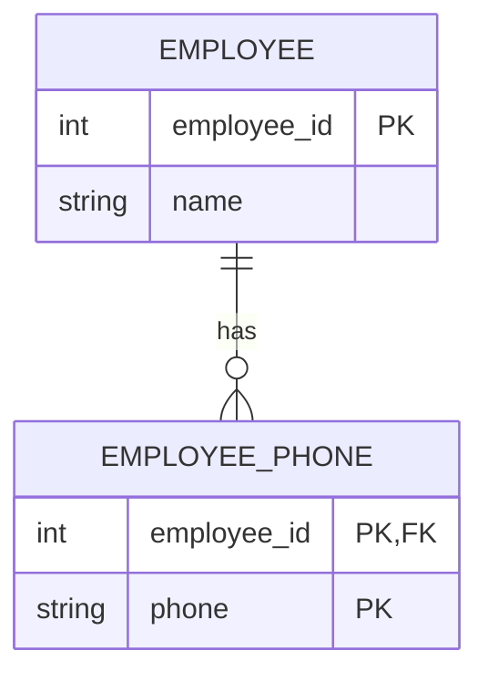
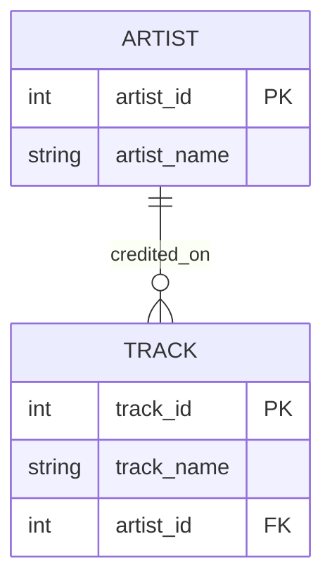

# Module 02 study log

Prepared on 2026-10-22 with AI assistance. This is a sourced technical draft, not evidence that a 30-minute pod session occurred. Updated on 2026-10-25 against the full module instructions; technical work and executed evidence are linked below.

## 1. References used

| Source | Concept clarified |
| --- | --- |
| Adrienne Watt, [Database Design, 2nd edition, Chapter 8](https://opentextbc.ca/dbdesign01/chapter/chapter-8-entity-relationship-model/) | A multivalued phone attribute can become a separate EmployeePhone entity. |
| SQLite, [Foreign Key Support](https://www.sqlite.org/foreignkeys.html) | A child reference must match a parent key; use NOT NULL when the relationship is mandatory. Enable foreign keys for each connection. |
| SQLite, [CREATE TABLE](https://www.sqlite.org/lang_createtable.html) | PRIMARY KEY, UNIQUE and NOT NULL are enforceable rules, including composite keys. |

## 2. Web searches performed by the assistant

- `site.opentextbc.ca dbdesign entity relationship model weak entity employee dependent` — found the textbook's entity/attribute examples and EmployeePhone model; [source](https://opentextbc.ca/dbdesign01/chapter/chapter-8-entity-relationship-model/).
- `site.sqlite.org foreignkeys CREATE TABLE UNIQUE composite primary key` — found official constraint and foreign-key documentation; [source](https://www.sqlite.org/foreignkeys.html), [CREATE TABLE](https://www.sqlite.org/lang_createtable.html).

These are the assistant's actual web-search terms, not a claim about the student's Google history.

## 3. Technical observations and counterexamples

- A plausible key name is not a uniqueness rule: an in-memory SQLite table with `part_no TEXT` accepted `P-1003` twice. A duplicate-count query returned `P-1003 | 2`.
- In a local machine/sensor experiment, two sensors referenced machine 1. Inserting a sensor for machine 99 failed with `FOREIGN KEY constraint failed` after enabling foreign keys.
- Row counts demonstrate an example instance; constraints express which future instances are allowed. Two sample rows alone do not prove a schema enforces cardinality.
- “Exactly one” needs both minimum and maximum participation. A unique child reference limits children per parent, but does not ensure every parent has a child.

## 4. LLM Q&A

The prompts below are explicit technical questions posed and answered within this AI-assisted preparation, not a retrospective claim about student prompts.

### Prompt: Which table holds the foreign key in a machine-to-sensor 1:n relationship?

Answer: Put machine_id on Sensor. A NOT NULL foreign key makes every sensor refer to one existing machine; it permits several sensors to share a machine.

Verification: The in-memory experiment inserted two sensors referencing machine 1 and rejected a reference to missing machine 99. This does not force every machine to have a sensor.

### Prompt: Is a column named part_no automatically a key?

Answer: No. The intended identifier needs an enforced uniqueness rule and, for a required identifier, NOT NULL. A column name has no constraint semantics.

Verification: The duplicate P-1003 insert succeeded without constraints. The rule is documented in SQLite CREATE TABLE. No contradiction was found in this check.

### Prompt: Does a UNIQUE foreign key enforce exactly one child for every parent?

Answer: No. It prevents two children sharing the same non-null parent reference. It does not require each parent to be referenced.

Verification: In the one-to-many experiment, a foreign key limited child references but did not impose a parent-side minimum. Official SQLite documentation defines a child-to-parent existence check; full 1:1 total participation needs an additional design decision or enforcement mechanism. The four sketches and executable proof are in [er-examples.md](er-examples.md).

## 5. Two selected found examples, redrawn

These are assistant-selected teaching examples. Mermaid drawings are original simplified redraws/adaptations, not screenshots. The explicit lower bounds below are stated assumptions rather than claims about every source diagram.

### Example A: Employee and multiple phone numbers

Source: Watt, Chapter 8, “Characteristic entities”, EmployeePhone example. Credit: Adrienne Watt / BCcampus; chapter credits include Nguyen Kim Anh. See the [source and its licence/attribution](https://opentextbc.ca/dbdesign01/chapter/chapter-8-entity-relationship-model/).

Lesson from this example: an owner's key can also be part of a child's composite identifier. A phone-number list becomes individual records. Assumption: an employee may have zero phone numbers; each phone record belongs to exactly one employee.

### Example B: Artist and tracks

Source: SQLite's [foreign-key tutorial, section 1](https://www.sqlite.org/foreignkeys.html). Redraw adapts the example by explicitly requiring the artist reference and assigning a track primary key.

Lesson from this example: a relationship line needs executable constraints. The original tutorial allows a NULL artist reference; this adaptation assumes `artist_id NOT NULL REFERENCES artist(artist_id)`. Unlike Example A, the child's identifier is independent of the parent key.

## Agreed learning (pod discussion)

The student confirmed a face-to-face discussion with another pod. There is no online conversation history. Specific shared conclusions, disagreements, participants and any shared image/post were not supplied; the student asked to revisit those details later. No agreement is invented. See [collaboration record](../COLLABORATION.md).

Candidate discussion points:

- Natural-key meaning needs an enforced uniqueness rule.
- Foreign keys belong on the many side for an ordinary 1:n mapping.
- Nullable references change minimum participation.
- Composite keys can identify an association or owner-dependent record.
- Sample counts and enforced cardinality are different kinds of evidence.

Open question: when should a nameplate have its own lifecycle/entity rather than be represented by required machine attributes?

## Remaining assignment evidence

- Completed with AI assistance: [four workshop sketches and CREATE TABLE + COUNT proof](er-examples.md).
- Document the specific takeaways and unresolved disagreements from the confirmed face-to-face discussion when revisiting it with the student.
- One image selected by the pods and shared to the course Discord channel.
- Completed and verified: the deliberately flawed legacy.db rebuilt from [legacy-setup.sql](legacy-setup.sql); the original .db was SQL text and has been preserved locally as legacy-original-text.sql.

## Verified technical continuation — 2026-10-25

- [Task B: Four workshop sketches and one executable cardinality proof](er-examples.md)
- [Task 1: Reconstructed legacy ER model and forgotten requirements](er-audit.md)
- [Measured legacy cardinalities](cardinality-results.md)
- [Task 2: Five integrity defects, queries, results and production impact](defect-results.md)
- [Task 3: Executable contract](contract.py), [DDL](contract-ddl.sql), [enforcement decisions](contract-notes.md)
- [Executed checks](verification.txt)

### Further concepts

A natural key has business meaning (serial_no/part_no); a surrogate ID decouples references from mutable labels. A surrogate does not remove the need to enforce business uniqueness. Technician names are not reliable identity keys.

A comma-separated parts_used field represents multiple relationships in one value. A junction table gives each job/part association its own row and composite key, making joins and uniqueness enforceable.

EER adds specialization/generalization, including whether subtypes overlap and whether every supertype belongs to a subtype. Relational implementations may use a discriminator or subtype tables; no inheritance is required for the base maintenance schema.

### Additional LLM question and verification

Prompt: Does a SQLite Date or NUMERIC declaration alone enforce valid calendar dates and exact monetary precision, and does drawing a mandatory 1:1 line enforce total participation?

AI answer: No. SQLite type affinity is not full domain validation. Calendar validity is checked in the Pydantic contract, numeric price checks are explicit, and foreign-key enforcement is enabled for every connection. A unique FK does not force a parent to have a child.

Verification: The executable checks reject an impossible calendar date through Pydantic, negative/over-precision prices, orphan references and duplicate junction pairs. The 1:1 sketch explicitly distinguishes its business rule from the weaker shared-FK implementation. Raw SQL date validity remains a documented limitation, not a claimed database guarantee.

Sources consulted for this continuation: [Pydantic validators](https://docs.pydantic.dev/latest/concepts/validators/), [SQLAlchemy SQLite foreign keys](https://docs.sqlalchemy.org/en/20/dialects/sqlite.html#foreign-key-support). No new web-search terms or personal pod experience are claimed.
