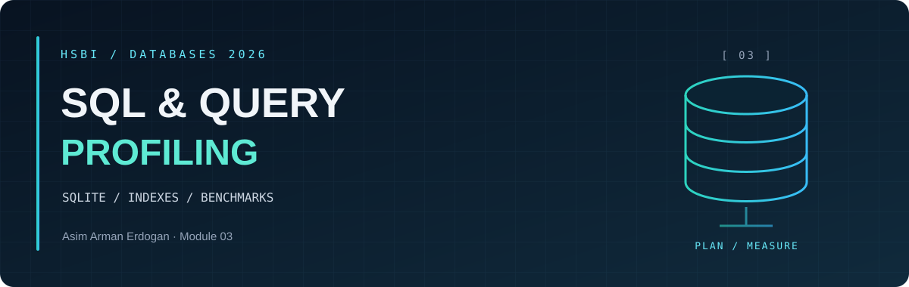
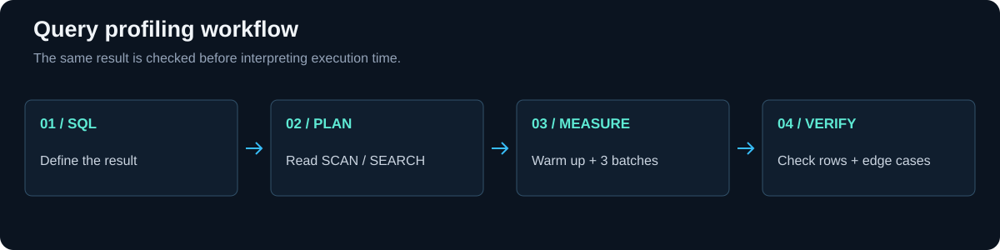

<p align="center"><sub>DATABASES 2026 &nbsp; / &nbsp; MODULE 03 &nbsp; / &nbsp; OVERVIEW</sub></p>

<h1 align="center">LLM-Assisted SQL and <em>Query Profiling</em></h1>

<table align="center">
<tr>
<td align="center"><strong>60,000</strong><br><sub>ORDERS</sub></td>
<td align="center"><strong>240,000</strong><br><sub>ORDER LINES</sub></td>
<td align="center"><strong>12</strong><br><sub>MEASURED VARIANTS</sub></td>
<td align="center"><strong>3</strong><br><sub>SAMPLES PER VARIANT</sub></td>
</tr>
</table>

<p align="center"><a href="#learning-goals">Learning goals</a> &nbsp; · &nbsp; <a href="benchmark-results.md">Benchmarks</a> &nbsp; · &nbsp; <a href="plan-safari-notes.md">Query plans</a> &nbsp; · &nbsp; <a href="warehouse-notes.md">Verification</a></p>

**Creator:** Asim Arman Erdogan.

---

[Course module](https://github.com/iotempire/iotempire-teaching/blob/main/full-classes/hsbi-databases-10d/modules/03-llm-assisted-sql-and-query-profiling.md) · [Portfolio](../README.md)

<a id="learning-goals"></a>

<h2 align="center">◈ <code>01</code> / Learning goals</h2>

1. Build **complex DQL queries** with joins, GROUP BY/HAVING, subqueries and window functions.
2. Read EXPLAIN QUERY PLAN: SCAN, SEARCH, table lookup and covering index.
3. Benchmark **index effects** and explain why an index is ignored.
4. Generate or critique AI SQL and verify correctness, performance and edge cases.
5. Prevent SQL injection with **bound parameters**.

<a id="task-status-and-evidence"></a>

<h2 align="center">◈ <code>02</code> / Task status and evidence</h2>

| Task | Evidence | Status |
| --- | --- | --- |
| A - Plan safari | [Current plans](plan-safari-notes.md), [runner](plan_safari.py) | Rechecked; existing records preserved |
| B - Algebra check | [Assisted comparison](task-b.md), [verification](task-b-verification.txt) | AI-assisted translation checked against SQL |
| C - Pod comparison | [Curiosity list](sql-notes.md), [collaboration record](../COLLABORATION.md) | Discussed in person; takeaways still to write down |
| Warehouse setup | [setup.sql](setup.sql), [checked counts](warehouse-check.txt) | 2,000 customers, 500 products, 60,000 orders, 240,000 lines |
| 1 - Dashboard | [SQL](dashboard.sql), [request and correctness](warehouse-notes.md), [predictions](plan-predictions.json), [plans/results](benchmark-results.md) | Reference-query alternative used and independently verified |
| 2 - Index benchmark | [bench.py](bench.py), [report](benchmark-results.md), [raw JSON](benchmark-results.json) | Three samples per variant; isolated/cumulative tests and negative controls passed |
| 3 - Injection | [demo](injection_demo.py), [output](injection-output.txt), [explanation](warehouse-notes.md) | Apostrophe crash, bypass and bound-parameter fix verified |
| 4 - Algebra to plan | [Dashboard algebra and verification](warehouse-notes.md) | Completed with AI assistance |
| 5 - Query rewrites | [SQL, results, plans and comparison](query-rewrites.md), [runner](query_rewrites.py) | Correlated subquery, window function and HAVING verified |
| Reflection | [Reflection 3](../Reflections/ref03.md) | Completed |



[Recorded dashboard benchmark chart](benchmark-results.md#benchmark-charts) · [Warehouse model](warehouse-notes.md#warehouse-model).

The technical work includes the core exercises and [extra comparisons of window functions, correlated subqueries and HAVING](query-rewrites.md).

<a id="reproduce-from-the-repository-root"></a>

<h2 align="center">◈ <code>03</code> / Reproduce from the repository root</h2>

```sh
uv run --locked python Module03-Restyle/bench.py
uv run --locked python Module03-Restyle/injection_demo.py
uv run --locked python Module03-Restyle/verify_task_b.py
uv run --locked python Module03-Restyle/plan_safari.py
uv run --locked python Module03-Restyle/query_rewrites.py
```

If warehouse.db is missing, first run `sqlite3 Module03-Restyle/warehouse.db ".read Module03-Restyle/setup.sql"`. This resets only the warehouse lab tables. If legacy.db is missing, use the [Module02-Restyle fixture](../Module02-Restyle/legacy-setup.sql) first. Database files **stay out of Git**.

The benchmark runs on a **temporary copy** and leaves warehouse.db unchanged. The safari resets its experiment index in Module02-Restyle/legacy.db and saves the results to plan-safari-notes.md. It leaves the study notes and algebra exercise alone.

<details>
<summary>Recreate the module visuals</summary>

```sh
uv run --no-project --script Module03-Restyle/render_visuals.py
uv run --no-project --script Module03-Restyle/plot_benchmarks.py
```

Charts use the recorded `benchmark-results.json`, not newly invented measurements. After rerunning the benchmark, rerun the chart script to update the graphics. The copied runners retain the presentation of regenerated reports and use the Module02-Restyle lab fixture.

</details>


---

<p align="center"><sub>MODULE 03 &nbsp; / &nbsp; SQL AND QUERY PROFILING</sub><br><a href="README.md">Module overview</a> &nbsp; · &nbsp; <a href="benchmark-results.md">Benchmarks</a> &nbsp; · &nbsp; <a href="../README.md">Portfolio</a></p>
