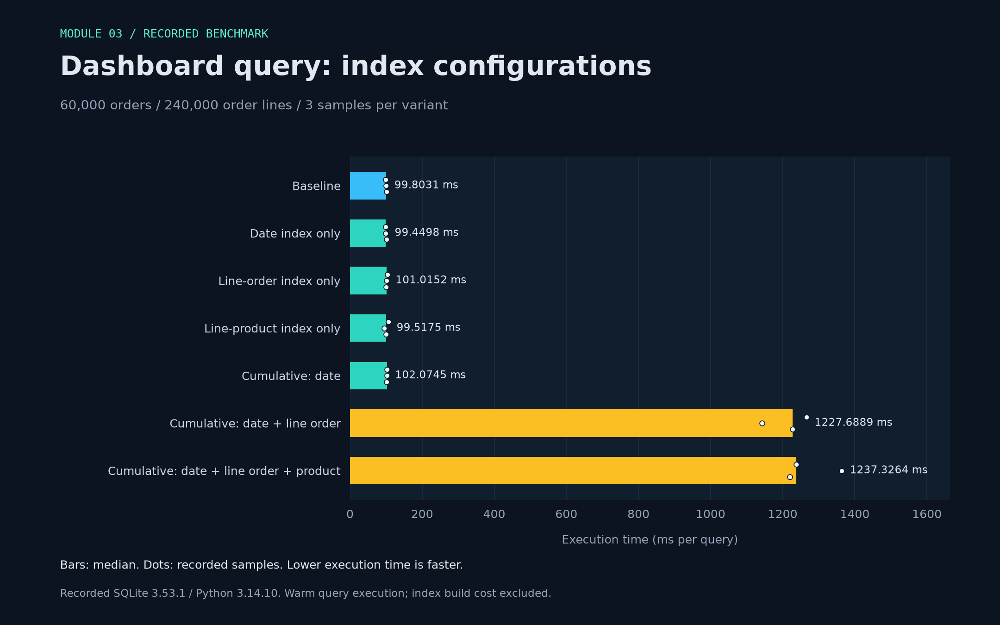
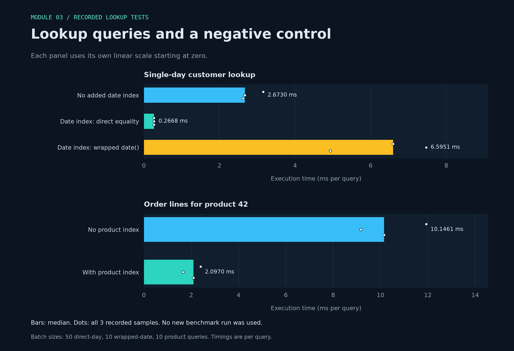

<p align="center"><sub>DATABASES 2026 &nbsp; / &nbsp; MODULE 03 &nbsp; / &nbsp; BENCHMARK RESULTS</sub></p>

<h1 align="center">Measured warehouse query plans</h1>

<a id="benchmark-charts"></a>



*Bars show the median; dots show the three recorded samples. All values are milliseconds per query. Index construction time is excluded.*



*Each panel has its own scale starting at zero. These are observations from one recorded environment, not universal speedup claims.* [Recorded data](benchmark-results.json) · [Chart script](plot_benchmarks.py).

*Recorded environment: SQLite 3.53.1; Python 3.14.10.*
perf_counter; same process/connection; one untimed warmup; 3 batches; execute+fetch; ms/query
**Index build cost is excluded**; this measures warm query execution, not end-to-end deployment cost.
Fresh fixture in a temporary disk database; the existing warehouse.db is opened read-only and unchanged.

<a id="dashboard-results"></a>

<h2 align="center">◈ <code>01</code> / Dashboard results</h2>

| city | distinct customers | revenue |
| --- | --- | --- |
| Bielefeld | 500 | 11242176.00 |
| Gütersloh | 500 | 8422344.00 |
| Münster | 500 | 5493504.00 |
| Paderborn | 500 | 2815656.00 |

<a id="benchmarks"></a>

<h2 align="center">◈ <code>02</code> / Benchmarks</h2>

| stage | query | samples ms/query | median ms/query | batch size |
| --- | --- | --- | --- | --- |
| baseline | dashboard | 98.3460, 99.8031, 100.8639 | 99.8031 | 1 |
| only ix_orders_ordered_on | dashboard | 99.4498, 98.9236, 101.7380 | 99.4498 | 1 |
| only ix_orderline_order | dashboard | 103.9837, 101.0152, 100.1408 | 101.0152 | 1 |
| only ix_orderline_product | dashboard | 107.0360, 95.1275, 99.5175 | 99.5175 | 1 |
| cumulative through ix_orders_ordered_on | dashboard | 102.0745, 102.7633, 101.2559 | 102.0745 | 1 |
| cumulative through ix_orderline_order | dashboard | 1266.2695, 1142.2625, 1227.6889 | 1227.6889 | 1 |
| cumulative through ix_orderline_product | dashboard | 1237.3264, 1363.8969, 1219.7808 | 1237.3264 | 1 |
| baseline | single day | 3.1546, 2.6730, 2.6178 | 2.6730 | 50 |
| date index | single day | 0.2684, 0.2660, 0.2668 | 0.2668 | 50 |
| date index | wrapped date | 6.5951, 7.4685, 4.9340 | 6.5951 | 10 |
| baseline | product lookup | 11.9305, 9.1651, 10.1461 | 10.1461 | 10 |
| product index | product lookup | 2.3955, 1.6481, 2.0970 | 2.0970 | 10 |

<a id="exact-plans-captured-before-timing"></a>

<h2 align="center">◈ <code>03</code> / Exact plans captured before timing</h2>

### baseline - dashboard
```text
(12, 0, 216, 'SCAN ol')
(14, 0, 45, 'SEARCH o USING INTEGER PRIMARY KEY (rowid=?)')
(21, 0, 45, 'SEARCH c USING INTEGER PRIMARY KEY (rowid=?)')
(24, 0, 45, 'SEARCH p USING INTEGER PRIMARY KEY (rowid=?)')
(27, 0, 0, 'USE TEMP B-TREE FOR GROUP BY')
(76, 0, 0, 'USE TEMP B-TREE FOR count(DISTINCT)')
(79, 0, 0, 'USE TEMP B-TREE FOR ORDER BY')
```

### only ix_orders_ordered_on - dashboard
```text
(12, 0, 216, 'SCAN ol')
(14, 0, 45, 'SEARCH o USING INTEGER PRIMARY KEY (rowid=?)')
(21, 0, 45, 'SEARCH c USING INTEGER PRIMARY KEY (rowid=?)')
(24, 0, 45, 'SEARCH p USING INTEGER PRIMARY KEY (rowid=?)')
(27, 0, 0, 'USE TEMP B-TREE FOR GROUP BY')
(76, 0, 0, 'USE TEMP B-TREE FOR count(DISTINCT)')
(79, 0, 0, 'USE TEMP B-TREE FOR ORDER BY')
```

### only ix_orderline_order - dashboard
```text
(12, 0, 216, 'SCAN ol')
(14, 0, 45, 'SEARCH o USING INTEGER PRIMARY KEY (rowid=?)')
(21, 0, 45, 'SEARCH c USING INTEGER PRIMARY KEY (rowid=?)')
(24, 0, 45, 'SEARCH p USING INTEGER PRIMARY KEY (rowid=?)')
(27, 0, 0, 'USE TEMP B-TREE FOR GROUP BY')
(76, 0, 0, 'USE TEMP B-TREE FOR count(DISTINCT)')
(79, 0, 0, 'USE TEMP B-TREE FOR ORDER BY')
```

### only ix_orderline_product - dashboard
```text
(12, 0, 216, 'SCAN ol')
(14, 0, 45, 'SEARCH o USING INTEGER PRIMARY KEY (rowid=?)')
(21, 0, 45, 'SEARCH c USING INTEGER PRIMARY KEY (rowid=?)')
(24, 0, 45, 'SEARCH p USING INTEGER PRIMARY KEY (rowid=?)')
(27, 0, 0, 'USE TEMP B-TREE FOR GROUP BY')
(76, 0, 0, 'USE TEMP B-TREE FOR count(DISTINCT)')
(79, 0, 0, 'USE TEMP B-TREE FOR ORDER BY')
```

### cumulative through ix_orders_ordered_on - dashboard
```text
(12, 0, 216, 'SCAN ol')
(14, 0, 45, 'SEARCH o USING INTEGER PRIMARY KEY (rowid=?)')
(21, 0, 45, 'SEARCH c USING INTEGER PRIMARY KEY (rowid=?)')
(24, 0, 45, 'SEARCH p USING INTEGER PRIMARY KEY (rowid=?)')
(27, 0, 0, 'USE TEMP B-TREE FOR GROUP BY')
(76, 0, 0, 'USE TEMP B-TREE FOR count(DISTINCT)')
(79, 0, 0, 'USE TEMP B-TREE FOR ORDER BY')
```

### cumulative through ix_orderline_order - dashboard
```text
(14, 0, 165, 'SEARCH o USING INDEX ix_orders_ordered_on (ordered_on>? AND ordered_on<?)')
(20, 0, 45, 'SEARCH c USING INTEGER PRIMARY KEY (rowid=?)')
(23, 0, 62, 'SEARCH ol USING INDEX ix_orderline_order (order_id=?)')
(28, 0, 45, 'SEARCH p USING INTEGER PRIMARY KEY (rowid=?)')
(31, 0, 0, 'USE TEMP B-TREE FOR GROUP BY')
(81, 0, 0, 'USE TEMP B-TREE FOR count(DISTINCT)')
(84, 0, 0, 'USE TEMP B-TREE FOR ORDER BY')
```

### cumulative through ix_orderline_product - dashboard
```text
(14, 0, 165, 'SEARCH o USING INDEX ix_orders_ordered_on (ordered_on>? AND ordered_on<?)')
(20, 0, 45, 'SEARCH c USING INTEGER PRIMARY KEY (rowid=?)')
(23, 0, 62, 'SEARCH ol USING INDEX ix_orderline_order (order_id=?)')
(28, 0, 45, 'SEARCH p USING INTEGER PRIMARY KEY (rowid=?)')
(31, 0, 0, 'USE TEMP B-TREE FOR GROUP BY')
(81, 0, 0, 'USE TEMP B-TREE FOR count(DISTINCT)')
(84, 0, 0, 'USE TEMP B-TREE FOR ORDER BY')
```

### baseline - single day
```text
(3, 0, 216, 'SCAN o')
(7, 0, 45, 'SEARCH c USING INTEGER PRIMARY KEY (rowid=?)')
```

### date index - single day
```text
(4, 0, 62, 'SEARCH o USING INDEX ix_orders_ordered_on (ordered_on=?)')
(9, 0, 45, 'SEARCH c USING INTEGER PRIMARY KEY (rowid=?)')
```

### date index - wrapped date
```text
(3, 0, 216, 'SCAN o')
(8, 0, 45, 'SEARCH c USING INTEGER PRIMARY KEY (rowid=?)')
```

### baseline - product lookup
```text
(2, 0, 216, 'SCAN order_line')
```

### product index - product lookup
```text
(3, 0, 62, 'SEARCH order_line USING INDEX ix_orderline_product (product_id=?)')
```

<a id="plan-and-time-changes-relative-to-dashboard-baseline"></a>

<h2 align="center">◈ <code>04</code> / Plan and time changes relative to dashboard baseline</h2>

- only ix_orders_ordered_on: plan changed=False; median/baseline=0.996 (faster in this run).
- only ix_orderline_order: plan changed=False; median/baseline=1.012 (slower in this run).
- only ix_orderline_product: plan changed=False; median/baseline=0.997 (faster in this run).
- cumulative through ix_orders_ordered_on: plan changed=False; median/baseline=1.023 (slower in this run).
- cumulative through ix_orderline_order: plan changed=True; median/baseline=12.301 (slower in this run).
- cumulative through ix_orderline_product: plan changed=True; median/baseline=12.398 (slower in this run).

<a id="verification"></a>

<h2 align="center">◈ <code>05</code> / Verification</h2>

- Independent Python aggregate agrees
- Year boundaries, DISTINCT, no-order fixture passed
- All benchmark results preserved
- Source warehouse file hash unchanged

Timings depend on the machine, cache and SQLite build. A changed plan proves a different strategy, not a universal speedup. No forced-index hints or disabled automatic indexes were used.

---

<p align="center"><sub>MODULE 03 &nbsp; / &nbsp; SQL AND QUERY PROFILING</sub><br><a href="README.md">Module overview</a> &nbsp; · &nbsp; <a href="benchmark-results.md">Benchmarks</a> &nbsp; · &nbsp; <a href="../README.md">Portfolio</a></p>
