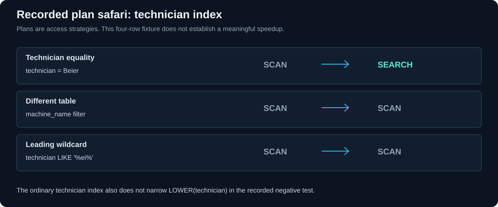

<p align="center"><sub>DATABASES 2026 &nbsp; / &nbsp; MODULE 03 &nbsp; / &nbsp; PLAN SAFARI</sub></p>

<h1 align="center">Task A: Plan Safari</h1>



*The visual summarizes the recorded plan comparison. SCAN and SEARCH describe access strategies, not elapsed times.*

<a id="objective"></a>

<h2 align="center">◈ <code>01</code> / Objective</h2>

Compare actual SQLite query plans before and after adding an ordinary index, and find predicates that cannot use it to narrow the search. Prepared with AI assistance using Python's built-in sqlite3; no SQLite CLI installation is needed.

<a id="original-predictions---recorded-before-this-run"></a>

<h2 align="center">◈ <code>02</code> / Original predictions - recorded before this run</h2>

| Query | Before-index prediction |
| --- | --- |
| Q1: `SELECT * FROM maint_job WHERE technician = 'Beier';` | SCAN |
| Q2: `SELECT * FROM machine WHERE machine_name = 'cnc-02';` | SCAN |
| Q3: `SELECT * FROM maint_job WHERE technician LIKE '%ei%';` | SCAN |

Database: `Module02-Restyle/legacy.db`. Python SQLite version: `3.53.1`.

Initial indexes: `[]`. No index existed, so none was removed.

<a id="actual-comparison"></a>

<h2 align="center">◈ <code>03</code> / Actual comparison</h2>

| Query | Prediction | Before | After |
| --- | --- | --- | --- |
| Q1 | SCAN | `SCAN maint_job` | `SEARCH maint_job USING INDEX ix_job_tech (technician=?)` |
| Q2 | SCAN | `SCAN machine` | `SCAN machine` |
| Q3 | SCAN | `SCAN maint_job` | `SCAN maint_job` |

<a id="exact-explain-query-plan-outputs"></a>

<h2 align="center">◈ <code>04</code> / Exact EXPLAIN QUERY PLAN outputs</h2>

Each tuple is `(id, parent, notused, detail)`, exactly as returned by Python.

### Before indexing

```sql
EXPLAIN QUERY PLAN SELECT * FROM maint_job WHERE technician = 'Beier';
```

```text
(2, 0, 216, 'SCAN maint_job')
```

```sql
EXPLAIN QUERY PLAN SELECT * FROM machine WHERE machine_name = 'cnc-02';
```

```text
(2, 0, 216, 'SCAN machine')
```

```sql
EXPLAIN QUERY PLAN SELECT * FROM maint_job WHERE technician LIKE '%ei%';
```

```text
(2, 0, 216, 'SCAN maint_job')
```

### After indexing

```sql
EXPLAIN QUERY PLAN SELECT * FROM maint_job WHERE technician = 'Beier';
```

```text
(3, 0, 62, 'SEARCH maint_job USING INDEX ix_job_tech (technician=?)')
```

```sql
EXPLAIN QUERY PLAN SELECT * FROM machine WHERE machine_name = 'cnc-02';
```

```text
(2, 0, 216, 'SCAN machine')
```

```sql
EXPLAIN QUERY PLAN SELECT * FROM maint_job WHERE technician LIKE '%ei%';
```

```text
(2, 0, 216, 'SCAN maint_job')
```

<a id="scan-versus-search"></a>

<h2 align="center">◈ <code>05</code> / SCAN versus SEARCH</h2>

SCAN means scanning a table or index rather than restricting traversal to a lookup range. SEARCH means visiting a subset using a key/index lookup. A plan is a **strategy**, not a timing measurement or proof of a speedup.

<a id="why-the-plans-behave-this-way"></a>

<h2 align="center">◈ <code>06</code> / Why the plans behave this way</h2>

Q1 compares the indexed technician value directly with one constant. An ordinary index can locate matching keys without inspecting every table row, then retrieve the matching records. On four rows, the overhead can outweigh any benefit; no meaningful speedup is claimed. SQLite may prefer SCAN in other data or statistics conditions. The recorded plan above is the observed result.

Q2 filters machine.machine_name, while the added index belongs to maint_job. That index cannot help locate rows in a different table. Q3 has a leading wildcard: the matching substring may occur anywhere, so there is no fixed leading prefix to turn into a narrow range of ordinary index keys. A scan is still needed for this query.

<a id="negative-experiments"></a>

<h2 align="center">◈ <code>07</code> / Negative experiments</h2>

```sql
EXPLAIN QUERY PLAN SELECT * FROM maint_job WHERE LOWER(technician) = 'beier';
```

```text
(2, 0, 216, 'SCAN maint_job')
```

```sql
EXPLAIN QUERY PLAN SELECT * FROM maint_job WHERE technician LIKE '%ei%';
```

```text
(2, 0, 216, 'SCAN maint_job')
```

LOWER(technician) asks SQLite to compare a computed expression. The normal index stores the original technician values, not the LOWER expression, so it cannot directly narrow this expression lookup. An appropriately matching expression index would be a different experiment; none was added. The repeated leading-wildcard LIKE is the second negative example.

<a id="prediction-check"></a>

<h2 align="center">◈ <code>08</code> / Prediction check</h2>

All three before-index SCAN predictions matched. No incorrect prediction is invented.

<a id="data-preservation-check"></a>

<h2 align="center">◈ <code>09</code> / Data-preservation check</h2>

All user-table row counts and SHA-256 fingerprints of sorted record representations were identical before and after. Query result sets also matched across the index change. Only the experiment index was added.

```json
{
  "machine": {
    "count": 4,
    "sha256": "504f995ecf8ba7b4cace289d514eecb06f0536be0b7a093864dc46aa65fc0a5b"
  },
  "maint_job": {
    "count": 4,
    "sha256": "11c927bb065949a26c38237f56a9cdfa317c2a94da2f750284c5373d1adaceea"
  },
  "part": {
    "count": 4,
    "sha256": "275c9b9306ff52a307857d83abd3b82610b6464b021913902576330b95f66033"
  }
}
```

<a id="conclusion"></a>

<h2 align="center">◈ <code>10</code> / Conclusion</h2>

An index helps when the filter can use its stored keys to find a smaller set of rows. It does not automatically help every query. We ran the plans and saw which searches used it, while keeping every existing database record unchanged.

<a id="files-and-replay"></a>

<h2 align="center">◈ <code>11</code> / Files and replay</h2>

- [SQL statements](plan-safari.sql): ordered record of this run, not a blindly repeatable reset script; the CREATE INDEX will fail if the experiment index already exists.
- [Python runner](plan_safari.py): checks the existing database and safely resets only a matching experiment index on later runs. Run with the project's Python interpreter.
See [module overview](README.md) for the algebra, warehouse and collaboration evidence.

---

<p align="center"><sub>MODULE 03 &nbsp; / &nbsp; SQL AND QUERY PROFILING</sub><br><a href="README.md">Module overview</a> &nbsp; · &nbsp; <a href="benchmark-results.md">Benchmarks</a> &nbsp; · &nbsp; <a href="../README.md">Portfolio</a></p>
