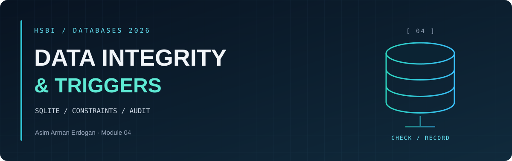
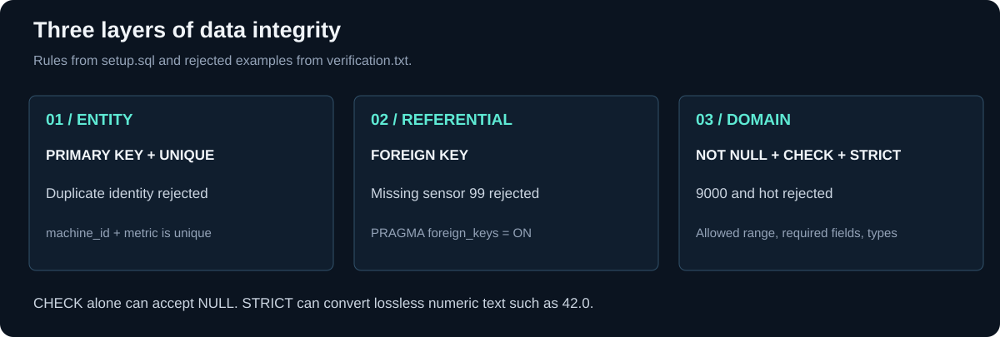

<p align="center"><sub>DATABASES 2026 &nbsp; / &nbsp; MODULE 04 &nbsp; / &nbsp; OVERVIEW</sub></p>

<h1 align="center">Data Integrity, <em>Constraints and Triggers</em></h1>

<table align="center">
<tr>
<td align="center"><strong>3</strong><br><sub>INTEGRITY LAYERS</sub></td>
<td align="center"><strong>10,000</strong><br><sub>INSERTS PER SAMPLE</sub></td>
<td align="center"><strong>5 + 5</strong><br><sub>RECORDED SAMPLES</sub></td>
<td align="center"><strong>2</strong><br><sub>TRIGGERS</sub></td>
</tr>
</table>

<p align="center"><a href="README.md">Overview</a> &nbsp; · &nbsp; <a href="integrity-notes.md">Integrity notes</a> &nbsp; · &nbsp; <a href="benchmark-results.md">Measurements</a> &nbsp; · &nbsp; <a href="access-control.md">Access control</a></p>

**Creator:** Asim Arman Erdogan.

---

[Course module](https://github.com/iotempire/iotempire-teaching/blob/main/full-classes/hsbi-databases-10d/modules/04-integrity-constraints-and-triggers.md) · [Portfolio](../README.md)

<a id="learning-goals"></a>

<h2 align="center">◈ <code>01</code> / Learning goals</h2>

1. Create tables with NOT NULL, UNIQUE, CHECK, PRIMARY KEY, FOREIGN KEY and STRICT typing.
2. Use generated columns to calculate values in the database.
3. Write triggers for domain rules and automatic audit records.
4. Use UPSERT to load repeated readings without creating duplicates.
5. Explain access control in SQLite and compare it with a database server.

<a id="task-status-and-evidence"></a>

<h2 align="center">◈ <code>02</code> / Task status and evidence</h2>

| Task | Evidence | Status |
| --- | --- | --- |
| A - Study | [Integrity notes](integrity-notes.md), [query checks](verification.txt) | Loose and constrained tables compared, including NULL and numeric text |
| B - Pod discussion | [Questions](integrity-notes.md#pod-discussion) | Discussion and agreed points still to record |
| 1 - Constraints | [Setup](setup.sql), [results](verification.txt) | Invalid values, types, references and duplicates rejected |
| 2 - CSV ingestion | [Python and UPSERT](ingest.py), [sample data](readings.csv), [checks](verification.txt) | Two runs kept four readings; corrected value checked |
| 3 - Alarm and audit | [Triggers](triggers.sql), [results](verification.txt), [timings](benchmark-results.json) | Alarm, value-change record and 10,000-row benchmark checked |
| 4 - Access control | [View](view.sql), [comparison](access-control.md) | Read-only access tested on Windows |
| 5 - BEFORE trigger | [Runner](verify_module04.py), [results](verification.txt) | Successful and rejected inserts compared |
| Reflection | [Reflection 4](../Reflections/ref04.md) | Technical draft; personal comments still to add |



[Trigger flow](integrity-notes.md#trigger-flow) · [Recorded trigger-cost chart](benchmark-results.md).

The technical work was prepared and checked with AI assistance. The [study notes](integrity-notes.md) explain the limits of the course schema, including the generated column's units and the INSERT-only alarm.

<a id="reproduce-from-the-repository-root"></a>

<h2 align="center">◈ <code>03</code> / Reproduce from the repository root</h2>

```sh
uv run --locked python Module04-Restyle/verify_module04.py
```

With the existing Windows environment, the same check can be run directly:

```powershell
.\.venv\Scripts\python.exe Module04-Restyle\verify_module04.py
```

The verifier creates `Module04-Restyle/edge.db` if it is missing. If it already exists, the checks use a temporary database and leave it unchanged. The runner updates only this module's verification and benchmark reports. Database files stay local.

To load the sample CSV into the prepared database:

```sh
uv run --locked python Module04-Restyle/ingest.py Module04-Restyle/readings.csv --db Module04-Restyle/edge.db
```

The UPSERT updates **`value` only**, as in the course example. Repeated loads preserve the number of readings, but can still create audit entries after the triggers have been installed.

<details>
<summary>Recreate the module visuals</summary>

```sh
uv run --no-project --script Module04-Restyle/render_visuals.py
uv run --no-project --script Module04-Restyle/plot_benchmarks.py
```

The chart reads the recorded `benchmark-results.json`. After rerunning the verifier, rerun the chart script to refresh both the chart and its report. Rebuilding visuals does not run a new benchmark.

</details>

---

<p align="center"><sub>MODULE 04 &nbsp; / &nbsp; DATA INTEGRITY</sub></p>

<p align="center"><a href="README.md">Overview</a> &nbsp; · &nbsp; <a href="integrity-notes.md">Integrity notes</a> &nbsp; · &nbsp; <a href="benchmark-results.md">Measurements</a> &nbsp; · &nbsp; <a href="access-control.md">Access control</a></p>
