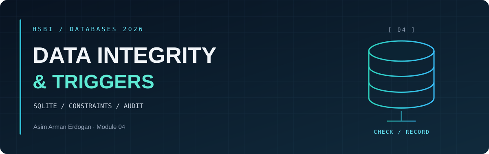

<p align="center"><sub>DATABASES 2026 &nbsp; / &nbsp; MODULE 04 &nbsp; / &nbsp; ACCESS CONTROL</sub></p>

<h1 align="center">Views, Connections and <em>File Access</em></h1>

<p align="center"><a href="README.md">Overview</a> &nbsp; · &nbsp; <a href="integrity-notes.md">Integrity notes</a> &nbsp; · &nbsp; <a href="benchmark-results.md">Measurements</a> &nbsp; · &nbsp; <a href="access-control.md">Access control</a></p>

The access checks were prepared and run with AI assistance. [view.sql](view.sql) defines the machine-health summary; [verification.txt](verification.txt) records the actual results.

<a id="view-and-read-only-connection"></a>

<h2 align="center">◈ <code>01</code> / View and read-only connection</h2>

The view groups readings by machine and metric, showing the peak value and reading count. It is created while the database is writable.

A separate connection opened with `mode=ro` could read all five readings. DELETE failed with `attempt to write a readonly database`. Another connection using `PRAGMA query_only=ON` rejected DELETE with the same error.

**A view makes a report easier to read**, but it does not stop someone with direct file access from querying the original tables. A connection owner can also turn query_only off.

<a id="file-permissions-on-windows"></a>

<h2 align="center">◈ <code>02</code> / File permissions on Windows</h2>

The course uses Unix `chmod`. On this Windows machine, the verifier temporarily set the database's read-only attribute through `os.chmod(path, 0o444)`. The write was rejected, and the original mode was restored in a finally block.

This demonstrates the Windows read-only attribute, not a complete NTFS permissions policy. The following is the course's Unix sequence for comparison; it was not run as a Unix permissions test here:

```sh
chmod 444 Module04-Restyle/edge.db
sqlite3 'file:Module04-Restyle/edge.db?mode=ro' 'SELECT COUNT(*) FROM reading;'
sqlite3 'file:Module04-Restyle/edge.db?mode=ro' 'DELETE FROM reading;'
chmod 644 Module04-Restyle/edge.db
```

<a id="comparison-with-postgresql"></a>

<h2 align="center">◈ <code>03</code> / Comparison with PostgreSQL</h2>

PostgreSQL authenticates users and grants permissions to roles through a server. SQLite relies on the application's connection and the operating system's control of the database file. Read-only access is useful for a trusted local reporting tool. A multi-tenant application needs authentication and tenant-specific authorization; handing out a database file does not provide that separation.

---

<p align="center"><sub>MODULE 04 &nbsp; / &nbsp; DATA INTEGRITY</sub></p>

<p align="center"><a href="README.md">Overview</a> &nbsp; · &nbsp; <a href="integrity-notes.md">Integrity notes</a> &nbsp; · &nbsp; <a href="benchmark-results.md">Measurements</a> &nbsp; · &nbsp; <a href="access-control.md">Access control</a></p>
