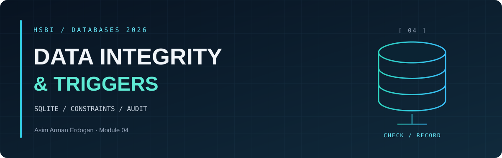
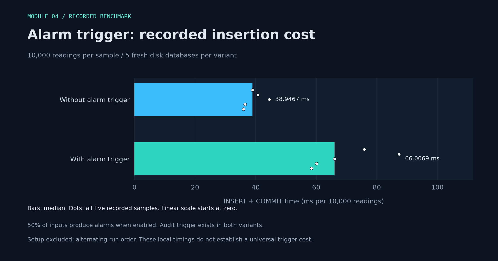

<p align="center"><sub>DATABASES 2026 &nbsp; / &nbsp; MODULE 04 &nbsp; / &nbsp; MEASUREMENTS</sub></p>

<h1 align="center">Alarm Trigger: <em>Recorded Cost</em></h1>

<p align="center"><a href="README.md">Overview</a> &nbsp; · &nbsp; <a href="integrity-notes.md">Integrity notes</a> &nbsp; · &nbsp; <a href="benchmark-results.json">Raw measurements</a></p>

<a id="trigger-benchmark"></a>

<h2 align="center">◈ <code>01</code> / Measured insertion time</h2>



| Variant | Median (ms per 10,000 readings) | Five recorded samples (ms) |
| --- | ---: | --- |
| Without alarm trigger | **38.9467** | 38.9467, 40.7722, 44.4693, 36.5155, 35.9808 |
| With alarm trigger | **66.0069** | 75.8505, 87.3236, 66.0069, 60.1386, 58.4360 |

<h2 align="center">◈ <code>02</code> / Method and interpretation</h2>

Five disk-backed fresh databases per variant; alternating order; 10,000 rows; 50% alarm-producing; timing includes INSERT and COMMIT, excludes setup.

The **audit trigger exists in both variants** and does not fire on these INSERTs. With the alarm trigger enabled, each sample produces **5,000 alarm rows**. The measured difference therefore includes both trigger work and the extra alarm writes.

Bars show medians; dots show all five samples. Seconds from the JSON are multiplied by 1,000 to display milliseconds. The axis is linear and starts at zero.

*These are recorded local results for this workload, not a universal trigger overhead or a prediction for other machines.* No new measurements are created by this plotting script.

<details>
<summary>Recreate the chart</summary>

```sh
uv run --no-project --script Module04-Restyle/plot_benchmarks.py
```

After running `verify_module04.py`, rerun this script to refresh the chart and this report from the updated JSON.

</details>

---

<p align="center"><sub>MODULE 04 &nbsp; / &nbsp; DATA INTEGRITY</sub><br><a href="README.md">Module overview</a> &nbsp; · &nbsp; <a href="integrity-notes.md">Integrity notes</a></p>
