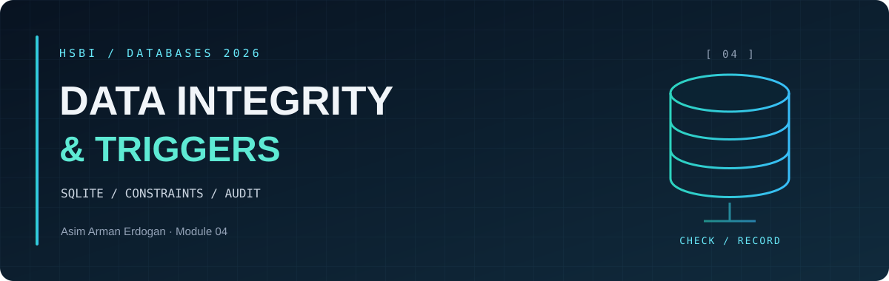
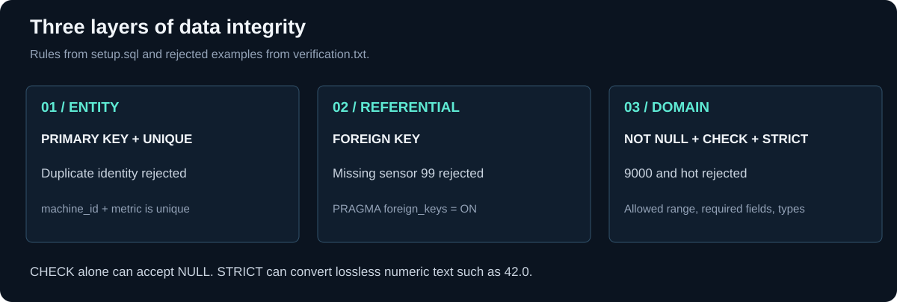
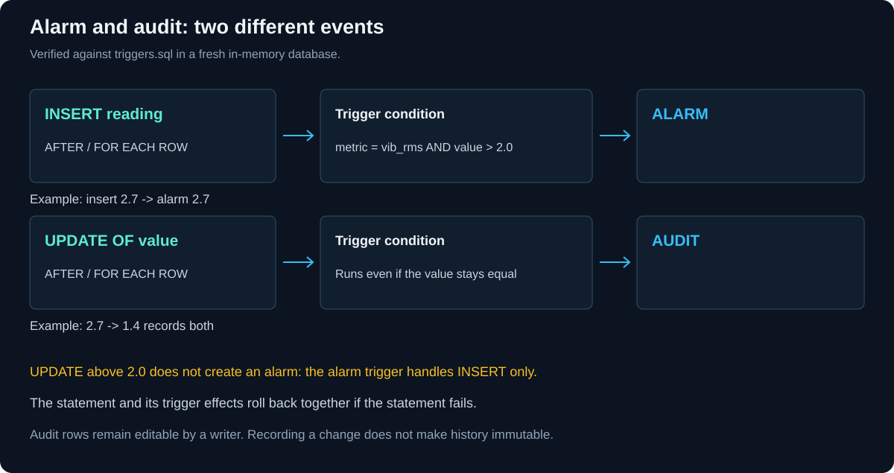
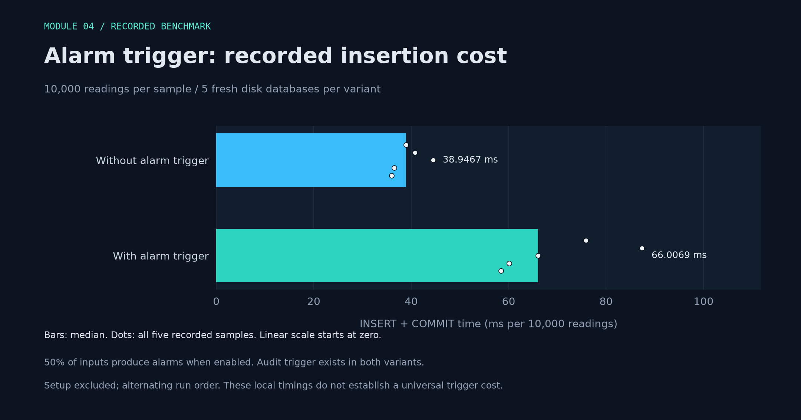

DATABASES 2026 &nbsp; / &nbsp; MODULE 04 &nbsp; / &nbsp; STUDY NOTES

<h1 align="center">Integrity <em>in practice</em></h1>

<a href="README.md">Overview</a> &nbsp; · &nbsp; <a href="integrity-notes.md">Integrity notes</a> &nbsp; · &nbsp; <a href="benchmark-results.md">Measurements</a> &nbsp; · &nbsp; <a href="access-control.md">Access control</a>

These explanations and experiments were prepared and checked with AI assistance. The exact SQL, input values and error messages are in [verification.txt](verification.txt).

<h2 align="center">◈ <code>01</code> / Task A: Three layers of integrity</h2>

| Layer | What it protects | Example from the checks |
| --- | --- | --- |
| Entity | The identity and required fields of a record | Duplicate sensor IDs and machine/metric pairs rejected |
| Referential | Relationships between records | Reading for missing sensor 99 rejected |
| Domain | The allowed values and types | 9000, 'hot', an unknown metric and a zero interval rejected |

**A key identifies a record; it does not prove that the reading is true.** NOT NULL makes a value required. STRICT checks types, while CHECK expresses rules about the values.

### What the loose table accepted

The table without constraints accepted a temperature of 9000, the text 'hot' in the value column, an unknown metric with -500, and a row containing only NULL values. The constrained table rejected the bad examples one at a time.

The most useful differences were:

- `CHECK(v > 0)` still allowed NULL. A required value also needs NOT NULL.
- STRICT accepted '42.0' because it could convert it to REAL without losing information. It rejected 'hot'.
- NULL in an INTEGER PRIMARY KEY generated a new ID.
- With foreign keys explicitly disabled, an orphan row was accepted. Enabling foreign keys rejected it, and `foreign_key_check` found the orphan in the unguarded example.

<h2 align="center">◈ <code>02</code> / Task 1: Constraints and the generated column</h2>

[setup.sql](setup.sql) defines the sensor and reading tables. The checks reject duplicate identities, missing required values, invalid types, missing sensor references and values outside the allowed range.

For the valid reading, `value = 41.5` and `interval_s = 1` produced a generated value of 41.5. This proves that the expression runs in SQLite. However, the course name `energy_j` is misleading: temperature, vibration or spindle load multiplied by seconds is not energy in joules. That calculation would need power in watts.

The broad range check does not validate the timestamp, match the unit to the metric, or prove that a plausible value came from the right physical sensor.

<h2 align="center">◈ <code>03</code> / Task 2: Repeated CSV ingestion</h2>

[ingest.py](ingest.py) uses a unique `(sensor_id, ts)` key and bound parameters. A new key inserts a reading; an existing key updates its value. The CSV was loaded twice, and the counts were four after the first run and four after the second. The original 41.5 reading was corrected to 41.7.

The course UPSERT updates only `value`. A corrected interval needs a separate decision. Once the audit trigger exists, replaying an unchanged value can still create a history row, so an unchanged reading count does not mean every side effect is unchanged.

<h2 align="center">◈ <code>04</code> / Task 3: Alarm, audit and performance</h2>

[triggers.sql](triggers.sql) adds an alarm after a new vibration reading above 2.0. Inserting 2.7 produced an alarm. Updating that reading to 1.4 produced an audit record containing the old and new values and the change time.

Two limitations were checked and then rolled back:

- Updating a reading from below the threshold to above it did not create another alarm. The trigger handles **INSERT**, not UPDATE.
- A writer could delete audit records. The trigger records history but does not make it immutable.

### Trigger-cost measurement

[Chart details and exact values](benchmark-results.md).

The [benchmark results](benchmark-results.json) contain five samples with the alarm trigger and five without it. Each sample uses a fresh disk database and 10,000 readings; half produce alarms when the trigger is enabled. The run order alternates to reduce ordering bias.

Timing includes the inserts and commit, but excludes database setup. The audit trigger exists in both variants and does not fire on these inserts. *These measurements describe this local workload; they do not establish a universal trigger cost.*

<h2 align="center">◈ <code>05</code> / Task 4: Access control</h2>

The [access-control notes](access-control.md) compare SQLite file/connection access with PostgreSQL roles. The view, read-only connection and rejected DELETE are recorded in the [checks](verification.txt).

<h2 align="center">◈ <code>06</code> / Task 5: BEFORE and AFTER</h2>

The optional experiment changed the alarm to BEFORE INSERT in an isolated database. A valid high reading still produced an alarm. An invalid reading of 9000 was rejected, and no additional alarm remained.

**Trigger effects belong to the same statement transaction.** AFTER fits this example because the alarm describes a reading that has been inserted. BEFORE does not create an independent alarm that survives a failed insert. Both kinds can reject a statement using `RAISE(ABORT, ...)`; this lab specifically checked the BEFORE rollback behaviour.

<h2 align="center">◈ <code>07</code> / Pod discussion</h2>

The discussion is still to be recorded. Questions to compare with another pod:

1. Which surprising row did your loose table accept?
2. Why did CHECK allow NULL, and what rejected it instead?
3. Why did STRICT accept '42.0' but reject 'hot'?
4. Why are machine_id and metric unique together?
5. What happens when an UPSERT changes vibration from below 2.0 to above it?
6. What would make the audit history harder to change or delete?

Add the participating pod, date, agreed points and unresolved questions after the conversation.

---

MODULE 04 &nbsp; / &nbsp; DATA INTEGRITY

<a href="README.md">Overview</a> &nbsp; · &nbsp; <a href="integrity-notes.md">Integrity notes</a> &nbsp; · &nbsp; <a href="benchmark-results.md">Measurements</a> &nbsp; · &nbsp; <a href="access-control.md">Access control</a>

