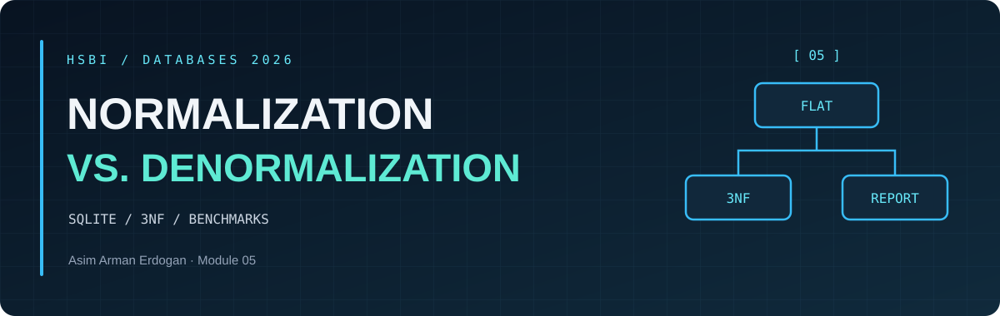
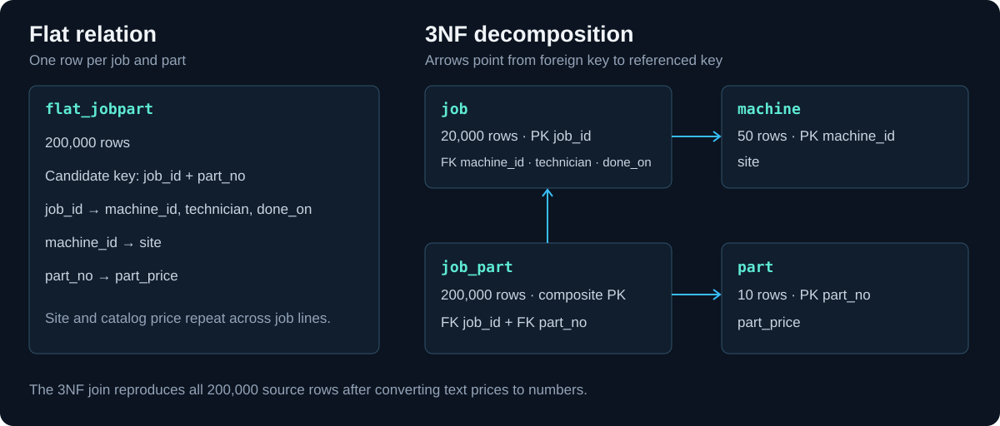

<p align="center"><sub>DATABASES 2026 &nbsp; / &nbsp; MODULE 05 &nbsp; / &nbsp; OVERVIEW</sub></p>
<h1 align="center">Normalization vs. <em>Denormalization</em></h1>

<table align="center">
<tr>
<td align="center"><strong>200,000</strong><br><sub>JOB-PART ROWS</sub></td>
<td align="center"><strong>20,000</strong><br><sub>JOBS</sub></td>
<td align="center"><strong>50</strong><br><sub>MACHINES</sub></td>
<td align="center"><strong>10</strong><br><sub>PARTS</sub></td>
</tr>
</table>

<p align="center"><a href="normalization-notes.md">Design notes</a> &nbsp; · &nbsp; <a href="benchmark-results.md">Measurements</a> &nbsp; · &nbsp; <a href="recommendation.md">Memo</a> &nbsp; · &nbsp; <a href="../Reflections/ref05.md">Reflection draft</a></p>

**Creator:** Asim Arman Erdogan. Implementation, notes and verification were prepared with AI assistance.

[Course module](https://github.com/iotempire/iotempire-teaching/blob/main/full-classes/hsbi-databases-10d/modules/05-normalization-vs-denormalization.md) · [Portfolio](../README.md)

<h2 align="center">◈ <code>01</code> / Portfolio evidence</h2>

| Round | Evidence |
| --- | --- |
| 1 · See it | [Dependencies, key and two ER sketches](normalization-notes.md#see-it) |
| 2 · Break it | [Three reproduced anomalies](normalization-notes.md#break-it) |
| 3 · Build it | [Seed and 3NF DDL](setup.sql), [verified row counts](benchmark-results.md) |
| 4 · Race it | [Report table](report.sql), [query times and plans](benchmark-results.md#query-plans) |
| 5 · Price it | [Write counts, storage and index experiment](benchmark-results.md#write-and-storage-cost) |
| 6 · Decide | [Recommendation to the operations lead](recommendation.md) |
| 7 · Harvest | [Curiosities with sources](normalization-notes.md#harvest), [DuckDB stretch](benchmark-results.md#duckdb) |



<h2 align="center">◈ <code>02</code> / Reproduce the lab</h2>

Run from the repository root. The first command runs the SQLite lab and the second refreshes its presentation.

```sh
uv run --no-project --python 3.14.8 Module05/benchmark.py
uv run --no-project --python 3.14.8 --with matplotlib python Module05/render_report.py
```

For the optional DuckDB comparison, use this benchmark command and then rerun the renderer.

```sh
uv run --no-project --python 3.14.8 --with duckdb python Module05/benchmark.py --duckdb
```

The runner builds fresh databases in a temporary directory and saves measurements to [benchmark-results.json](benchmark-results.json). [The chart and tables](benchmark-results.md) show one recorded local run. The seven peer gates, the curiosity exchange and the personal reflection require participation in class.
