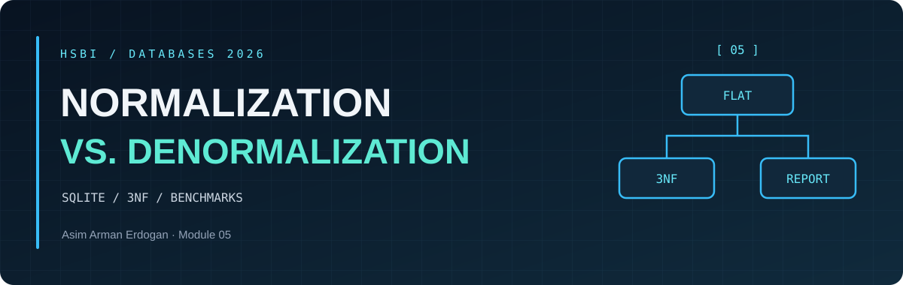
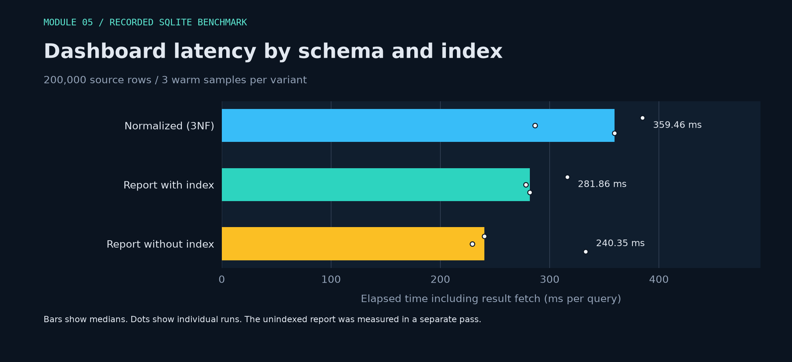

DATABASES 2026 &nbsp; / &nbsp; MODULE 05 &nbsp; / &nbsp; MEASUREMENTS

<h1 align="center">Normalization <em>Benchmark</em></h1>

<a href="README.md">Overview</a> &nbsp; · &nbsp; <a href="normalization-notes.md">Design notes</a> &nbsp; · &nbsp; <a href="benchmark-results.md">Measurements</a> &nbsp; · &nbsp; <a href="recommendation.md">Memo</a>

<h2 align="center">◈ <code>03</code> / Verified build</h2>

| Table | Rows |
| --- | ---: |
| flat_jobpart | 200,000 |
| machine | 50 |
| part | 10 |
| job | 20,000 |
| job_part | 200,000 |
| report_jobpart | 200,000 |

The reconstructed rows matched the flat source, including multiplicities. Both dashboard queries returned **350 groups** and total parts cost **722,610.00** for dates on or after 2026-03-01.

<h2 align="center">◈ <code>04</code> / Warm dashboard reads</h2>

Python 3.14.8, SQLite 3.53.1, 65,536 KiB SQLite page cache. Each variant had one untimed warm-up before three timed runs. A and B alternated their starting order. Timings include fetching all rows. The index test is a separate paired pass after dropping the report index.

| Variant | Samples (ms) | Median (ms) |
| --- | --- | ---: |
| Normalized (3NF) | 384.9619, 286.6792, 359.4608 | **359.4608** |
| Report with index | 316.1922, 278.1535, 281.8619 | **281.8619** |
| Report without index | 240.3487, 229.2413, 332.8022 | **240.3487** |
| 3NF control in the index pass | 372.4950, 326.3903, 430.0777 | 372.4950 |

### Query plans

**Normalized (3NF)**

~~~text
SCAN jp
SEARCH j USING INTEGER PRIMARY KEY (rowid=?)
SEARCH m USING INDEX sqlite_autoindex_machine_1 (machine_id=?)
SEARCH p USING INDEX sqlite_autoindex_part_1 (part_no=?)
USE TEMP B-TREE FOR GROUP BY
~~~

**Report with index**

~~~text
SCAN report_jobpart USING INDEX ix_report_machine
USE TEMP B-TREE FOR GROUP BY
~~~

**Report without index**

~~~text
SCAN report_jobpart
USE TEMP B-TREE FOR GROUP BY
~~~

The indexed report plan walks the machine index across the full report. The date predicate has no index in this fixture. Removing the machine index permits a direct table scan. All plans shown were captured on the same SQLite version.

<h2 align="center">◈ <code>05</code> / Write and storage cost</h2>

| Site update for cnc-02 | Rows changed | Statement samples (ms) | Median (ms) |
| --- | ---: | --- | ---: |
| machine | **1** | 1.8078, 1.6456, 2.9381 | 1.8078 |
| report_jobpart | **4,000** | 38.9524, 41.2182, 66.0856 | 41.2182 |

The indexed report and 3NF tables were updated in separate transactions and rolled back after timing. Timing covers the statement and excludes transaction start, commit and rollback.

| Objects | Table KiB | Index KiB | Total KiB |
| --- | ---: | ---: | ---: |
| 3NF | 3,976 | 4,000 | 7,976 |
| Indexed report | 10,832 | 2,920 | 13,752 |
| Unindexed report | 10,832 | 0 | 10,832 |

SQLite dbstat measured allocated object pages. The flat seed, database metadata and freelist are outside these totals. Retaining both 3NF and the report adds the full report footprint to the transactional schema.

### Wider SQLite comparison

The optional vendor and site dimensions produced **3,500 matching groups** and total **722,610.00**. The six-table query took **641.8900 ms** at the median. The wider report with no index took **477.8706 ms**. The extra joins and added dimensions change the workload.

### DuckDB stretch

DuckDB 2.0.0 imported the same SQLite rows into native disk tables and ran with one worker thread. Both queries returned all 350 expected groups. Import time is outside the measurements.

| DuckDB variant | Samples (ms) | Median (ms) |
| --- | --- | ---: |
| Normalized | 38.9536, 37.0799, 41.1122 | 38.9536 |
| Report table | 18.7838, 18.0172, 19.6168 | 18.7838 |

The 3NF query already runs within a 30-second refresh interval in this fixture. Compare against the actual dashboard latency target and freshness requirements before keeping a separate report.

[Raw samples, query plans and verification results](benchmark-results.json)
