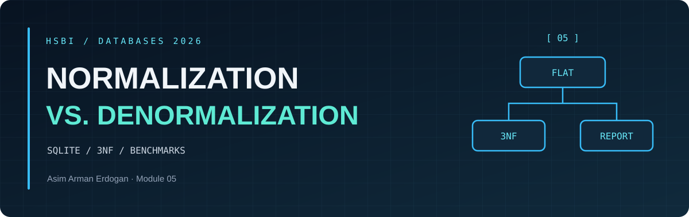
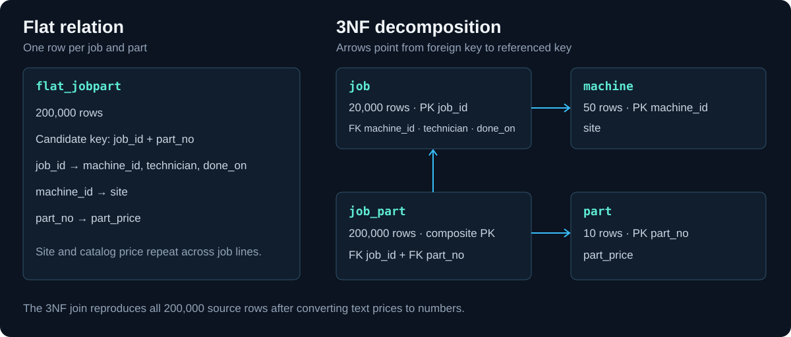

DATABASES 2026 &nbsp; / &nbsp; MODULE 05 &nbsp; / &nbsp; DESIGN NOTES

<h1 align="center">Dependencies, <em>Keys and Anomalies</em></h1>

<a href="README.md">Overview</a> &nbsp; · &nbsp; <a href="benchmark-results.md">Measurements</a> &nbsp; · &nbsp; <a href="recommendation.md">Memo</a>

<h2 align="center">◈ <code>01</code> / See it</h2>

| Dependency | Basis |
| --- | --- |
| `job_id → machine_id, technician, done_on` | Each job has one machine, technician and completion date in this model. |
| `machine_id → site` | Each machine has one current site. A history of site changes would need an effective date. |
| `part_no → part_price` | The lab keeps one catalog price per part. Historical purchase prices would belong on the job-part line or in a price history. |
| `machine_id → technician` | Observed in the five rows only. The larger fixture assigns seven distinct technicians to `cnc-02`. |
| `site → machine_id` | Refuted by the extract. Gütersloh contains both machines. |
| `part_price → part_no` | Observed in the five rows only. Two catalog items may share a price. |

**Candidate key.** A job uses each part number at most once in this model. The pair `(job_id, part_no)` determines all other attributes through the listed dependencies. Removing either column loses uniqueness, as the five-row extract shows.

**AI comparison.** The AI-assisted first pass grouped the five rows by each possible determinant and flagged `machine_id → technician` and `part_price → part_no` as patterns. The domain review classifies both as observations. The larger fixture directly breaks the first pattern. Equal prices for two different parts would break the second. The tested result is in [the benchmark runner](benchmark.py).

<h2 align="center">◈ <code>02</code> / Break it</h2>

The [five-row fixture](anomalies.sql) and [runner](benchmark.py) reproduce each case.

| Case | SQL | Observed result |
| --- | --- | --- |
| Update | `UPDATE flat5 SET site = 'Bielefeld' WHERE machine_id = 'cnc-01';` | Three rows changed. A second writer hit `SQLITE_BUSY` while the transaction was open. After the first commit, a partial edit of job 3 left Bielefeld and Paderborn for the same machine. |
| Insert | `INSERT INTO flat5(part_no, part_price) VALUES ('P-9999', 12.50);` | The permissive table accepted `(NULL, NULL, NULL, NULL, 'P-9999', 12.5)`. It cannot represent an unused part as a complete job-part row. |
| Delete | `DELETE FROM flat5 WHERE job_id = 1;` | Two rows disappeared, including the only use of P-0002. Its catalog price, 7.00, disappeared with it. |

<h2 align="center">◈ <code>03</code> / Build it</h2>

1. **1NF.** Each job-part row contains a single part number and atomic fields. The flat fixture already has this shape.
2. **2NF.** Move job attributes to `job` and catalog price to `part`. Both are determined by only one component of the composite key. Keep the pair in `job_part`.
3. **3NF.** Move site to `machine` so a job refers to its machine without storing the transitively determined site.

The [setup SQL](setup.sql) generates 20,000 jobs and ten distinct part numbers. The `% 40` expression receives only the values 1 through 10. Foreign keys are enabled before loading. The check compares **all 200,000 reconstructed rows, with duplicates counted**, after converting the source price strings to numbers. `foreign_key_check` returned zero violations and `integrity_check` returned `ok`.

<h2 align="center">◈ <code>07</code> / Harvest</h2>

| Curiosity | Where to check |
| --- | --- |
| Why does the generator produce exactly 200,000 rows and only ten catalog parts? | [The two recursive sequences](setup.sql) |
| What assumption does `SELECT DISTINCT` make about technicians? | [The job key and load](setup.sql). Two different technicians for one job would give two rows for the same primary key. |
| Why can an index scan lose to a table scan? | [Measured plans](benchmark-results.md#query-plans) |
| How much storage belongs to indexes? | [The storage breakdown](benchmark-results.md#write-and-storage-cost) and [SQLite dbstat](https://www.sqlite.org/dbstat.html) |
| When would current catalog price give the wrong historical cost? | [The part-price assumption](#see-it) |

**Pod exchange pending.** Compare curiosity lists and record the peer's questions and the points agreed during the discussion.
