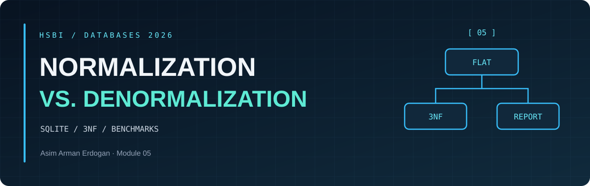

DATABASES 2026 &nbsp; / &nbsp; MODULE 05 &nbsp; / &nbsp; RECOMMENDATION

<h1 align="center">Memo to the <em>Operations Lead</em></h1>

<a href="README.md">Overview</a> &nbsp; · &nbsp; <a href="normalization-notes.md">Design notes</a> &nbsp; · &nbsp; <a href="benchmark-results.md">Measurements</a> &nbsp; · &nbsp; <a href="recommendation.md">Memo</a>

Yasmin, I recommend serving the dashboard from the normalized query for this workload and keeping the transactional tables in **3NF**.
The [recorded benchmark](benchmark-results.md) measured **359.4608 ms** for the normalized query, **281.8619 ms** for the indexed report and **240.3487 ms** for the unindexed report, with the same 350 result groups.
The normalized query fits the lab's 30-second refresh interval, and a site change updates **1 row** in the source compared with **4,000 rows** in the report copy.
The unindexed report would add **10,832 KiB** of allocated table pages alongside the 3NF data.
If production profiling shows that the join misses the latency target, test the unindexed report with a scheduled rebuild from the source tables.
Build and validate the replacement, then swap it into service in one transaction so readers get a complete snapshot.
Show the last successful refresh time and fall back to the normalized query if the snapshot exceeds the agreed freshness limit.
