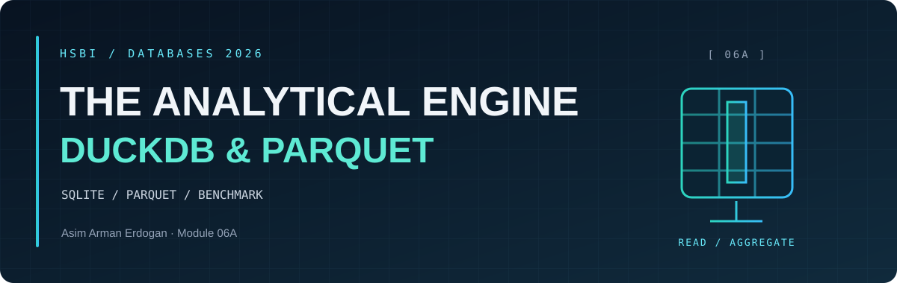
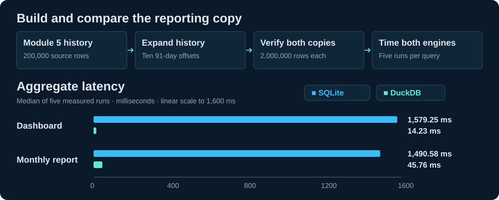

<p align="center"><sub>DATABASES 2026 &nbsp; / &nbsp; MODULE 06A &nbsp; / &nbsp; OVERVIEW</sub></p>
<h1 align="center">The Analytical Engine: <em>DuckDB and Parquet</em></h1>

<table align="center">
<tr>
<td align="center"><strong>2,000,000</strong><br><sub>HISTORY ROWS</sub></td>
<td align="center"><strong>111.01×</strong><br><sub>DASHBOARD SPEEDUP</sub></td>
<td align="center"><strong>32.57×</strong><br><sub>MONTHLY SPEEDUP</sub></td>
<td align="center"><strong>1.38 MB</strong><br><sub>ZSTANDARD PARQUET</sub></td>
</tr>
</table>

<p align="center"><a href="#-01--learning-goals">Learning goals</a> &nbsp; · &nbsp; <a href="duckdb-notes.md#aggregate-timings">Benchmarks</a> &nbsp; · &nbsp; <a href="duckdb-notes.md#query-plans">Query plans</a> &nbsp; · &nbsp; <a href="duckdb-notes.md#memo-to-lea-winter-and-yasmin-kaya">Refresh memo</a></p>

**Creator:** Asim Arman Erdogan. Implementation, notes and verification were prepared with AI assistance.

[Course module](https://github.com/iotempire/iotempire-teaching/blob/main/full-classes/hsbi-databases-10d/modules/06a-duckdb-analytical-engine.md) · [Module 5 evidence](../Module05/benchmark-results.md) · [Module 6b](../Module06b/README.md) · [Portfolio](../README.md)

<h2 align="center">◈ <code>01</code> / Learning goals</h2>

- Extend the Module 5 history and verify that SQLite and Parquet contain the same row count and total part price.
- Compare aggregate latency on the same data and interpret each engine's query plan.
- Measure the cost of small inserts and primary-key lookups in both engines.
- Recommend a refresh schedule and define which workloads use each engine.

<h2 align="center">◈ <code>02</code> / Task status and evidence</h2>

| Task | Evidence | Status |
| --- | --- | --- |
| Build history | [Preparation script](prepare.py), [row counts and sizes](duckdb-notes.md#build-and-verify) | 2,000,000 rows generated |
| Convert to Parquet | [Conversion script](to_parquet.py), [compression comparison](duckdb-notes.md#build-and-verify) | Counts and totals matched on both copies |
| Race the aggregates | [Benchmark script](race.py), [measured timings](duckdb-notes.md#aggregate-timings) | Five timed runs per engine and query |
| Read the plans | [Plan script](plan.py), [operator evidence](duckdb-notes.md#query-plans) | SQLite scan and DuckDB operators recorded |
| Measure the boundary | [Boundary script](boundary.py), [insert and lookup timings](duckdb-notes.md#transaction-boundary) | 1,000 operations per run and method |
| Decide and refresh | [Memo to Lea and Yasmin](duckdb-notes.md#memo-to-lea-winter-and-yasmin-kaya) | Workload placement and nightly refresh documented |
| Reflect | [Reflection draft](../Reflections/ref06a.md) | Draft available |



<h2 align="center">◈ <code>03</code> / Reproduce from the repository root</h2>

The first command reuses Module 5’s tracked setup and report scripts. Generated databases, CSV and Parquet are written to the ignored `Module06a/output/` directory.

```sh
uv run --no-project python Module06a/prepare.py
uv run --no-project --with duckdb==2.0.1 python Module06a/to_parquet.py
uv run --no-project --with duckdb==2.0.1 python Module06a/race.py
uv run --no-project --with duckdb==2.0.1 python Module06a/plan.py
uv run --no-project --with duckdb==2.0.1 python Module06a/boundary.py
```
