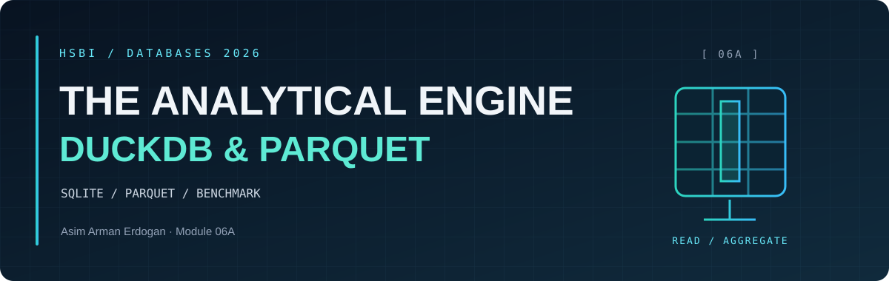

DATABASES 2026 &nbsp; / &nbsp; MODULE 06A &nbsp; / &nbsp; EVIDENCE

<h1 align="center">DuckDB: <em>Measurements and Recommendation</em></h1>

<a href="README.md">Overview</a> &nbsp; · &nbsp; <a href="#aggregate-timings">Benchmarks</a> &nbsp; · &nbsp; <a href="#query-plans">Query plans</a> &nbsp; · &nbsp; <a href="#memo-to-lea-winter-and-yasmin-kaya">Refresh memo</a>

## Build and verify

The Module 5 baseline had 200,000 job-part rows. Its recorded table sizes were 3,976 KiB for 3NF and 10,832 KiB for the unindexed report. A site change touched one 3NF row and 4,000 report rows. The unindexed report's median was 240.35 ms versus 281.86 ms with the machine index in that pass. [Module 5 measurements](../Module05/benchmark-results.md)

The build applied ten offsets spaced 91 days apart. Each offset kept all 200,000 rows, yielding 2,000,000 rows from 2026-01-01 through 2028-06-27. The UTF-8 CSV contains the 200,000 original rows and occupies 10,805,002 bytes. A 90-day offset would shorten the overall range and remove the one-day gap between adjacent copies of this 90-day fixture. Calendar-month offsets would vary with month length.

| Storage | Rows | Sum of part prices | Bytes |
| --- | ---: | ---: | ---: |
| SQLite history | 2,000,000 | 21,000,000.00 | 112,660,480 |
| Snappy Parquet | 2,000,000 | 21,000,000.00 | 2,320,560 |
| Zstandard Parquet | 2,000,000 | 21,000,000.00 | 1,384,158 |

Zstandard saved 936,402 bytes (40.4%) versus Snappy. The race uses Snappy. Counts and totals catch many copy errors, and the race also checks every aggregate group. A wrong set of individual rows can still share the same count and total. A canonical row-level hash would provide a stronger check.

## Aggregate timings

GitHub-hosted Ubuntu runner, SQLite 3.46.1 and DuckDB 2.0.1. One untimed warm-up per engine per query, five timed runs per engine, alternating which engine goes first, including result fetching. [Run and raw output](https://github.com/asimarmanerdogan-crypto/Databases2026/actions/runs/45710630452/job/139543808741)

| Query | Matching groups | SQLite median [range], ms | DuckDB median [range], ms | SQLite / DuckDB |
| --- | ---: | ---: | ---: | ---: |
| Dashboard | 350 | 1,579.25 [1,530.63–1,604.59] | 14.23 [13.59–15.39] | 111.01× |
| Monthly | 1,500 | 1,490.58 [1,487.30–1,500.80] | 45.76 [45.18–46.69] | 32.57× |

The monthly query formats each date before grouping. The additional per-row computation is consistent with the smaller speedup. An indexed lookup that selects only a few rows is a different workload.

## Query plans

For the same unfiltered aggregate, the SQLite plan showed a report_history scan and a temporary B-tree for grouping. DuckDB reported 17.0 ms total elapsed time and 181.8 kB read. The output below is condensed from the measured plan.

| DuckDB operator | Rows returned | Reported operator time |
| --- | ---: | ---: |
| Table Scan (READ_PARQUET, all 17 row groups, four projected columns) | 2,000,000 | 10.0 ms |
| Projection | 2,000,000 | 0 µs |
| **Hash Group By** | **350** | **40.0 ms** |

Hash Group By reported the largest operator time in this run because it processed the full 2,000,000-row input, even though it emitted only 350 groups. The operator times reflect work across threads and can exceed the wall-clock total. The scan read only machine ID, site, technician and part price from seven available columns.

## Transaction boundary

The benchmark used two in-memory engines, one explicit transaction for the 1,000 insert calls in each variant, and 1,000 verified primary-key lookups.

| Insert method | SQLite insert / lookup, ms | DuckDB insert / lookup, ms |
| --- | ---: | ---: |
| Per-row calls | 1.14 / 1.54 | 365.17 / 323.79 |
| executemany | 0.56 / 1.54 | 132.84 / 324.31 |

DuckDB's write time improved by about 2.75× with executemany. SQLite stayed faster for per-key operations on this fixture, so the operational ingest and immediate record lookups belong in SQLite.

## Memo to Lea Winter and Yasmin Kaya

Move the month-end aggregate and other historical scans to DuckDB over a Parquet copy. Keep job ingest, keyed updates and live lookups in SQLite. The month-end query fell from 1,490.58 ms to 45.76 ms and the dashboard aggregate from 1,579.25 ms to 14.23 ms on the same history. The Snappy file occupied 2.32 MB, while the verified Zstandard option used 1.38 MB. Refresh the report after the last shift each day and surface the timestamp of the last verified export. If the export is a day old, the report omits the latest completed shift's jobs, so reconcile or rebuild before closing the month. Keep request-per-row lookups in SQLite, where 1,000 reads took 1.54 ms against 323.79 ms in DuckDB.

For the nightly refresh, have the scheduled reporting job read a consistent SQLite snapshot, write a temporary Parquet file, verify row count and total against that snapshot and replace the published file only after validation. Record the source watermark and completion time, then alert if the watermarked export falls behind the daily schedule. Otherwise a stopped job leaves a readable but stale file and the next month-end total can silently exclude completed work. The scripts here reproduce the course benchmark and the Zstandard copy.

The discussion prompts above are addressed as written practice. Peer discussion is a separate class activity.
