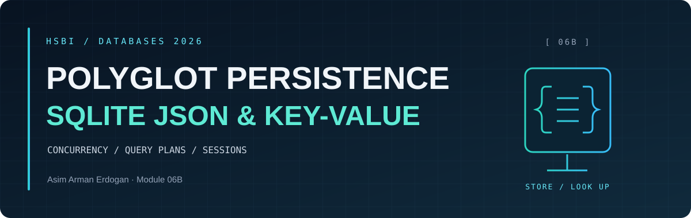
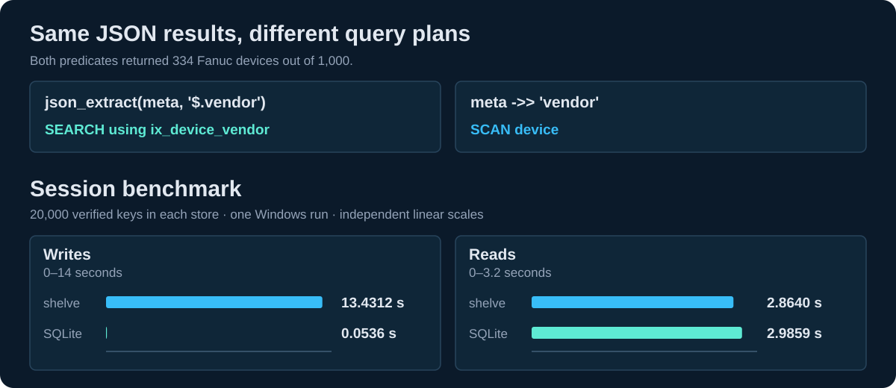

<p align="center"><sub>DATABASES 2026 &nbsp; / &nbsp; MODULE 06B &nbsp; / &nbsp; OVERVIEW</sub></p>
<h1 align="center">Polyglot Persistence: <em>SQLite JSON and Key-Value</em></h1>

<table align="center">
<tr>
<td align="center"><strong>1,000</strong><br><sub>DEVICE RECORDS</sub></td>
<td align="center"><strong>334</strong><br><sub>MATCHING DEVICES</sub></td>
<td align="center"><strong>20,000</strong><br><sub>VERIFIED SESSION KEYS</sub></td>
<td align="center"><strong>2</strong><br><sub>SQLITE CONNECTIONS</sub></td>
</tr>
</table>

<p align="center"><a href="#-01--learning-goals">Learning goals</a> &nbsp; · &nbsp; <a href="study-notes.md#task-1--local-and-remote-writes">Concurrency</a> &nbsp; · &nbsp; <a href="study-notes.md#task-2--vendor-json-and-session-keys">JSON and sessions</a> &nbsp; · &nbsp; <a href="study-notes.md#task-3--kortmann-decision-record">Decision record</a></p>

**Creator:** Asim Arman Erdogan. Implementation, notes and verification were prepared with AI assistance.

[Course module](https://github.com/iotempire/iotempire-teaching/blob/main/full-classes/hsbi-databases-10d/modules/06b-polyglot-persistence.md) · [Module 6a](../Module06a/README.md) · [Portfolio](../README.md)

<h2 align="center">◈ <code>01</code> / Learning goals</h2>

- Explain how concurrent writes behave in SQLite and what changes when clients connect to a server.
- Query JSON, compare equivalent predicates and identify when SQLite can use an expression index.
- Benchmark key-value access using the same session data in Python shelve and SQLite.
- Choose an engine per workload and document the evidence, trade-offs and freshness requirements.

<h2 align="center">◈ <code>02</code> / Task status and evidence</h2>

| Task | Evidence | Status |
| --- | --- | --- |
| Local and remote writes | [Two-connection script](concurrency.py), [observations and theory](study-notes.md#task-1--local-and-remote-writes) | SQLite fallback executed. The live PostgreSQL demo is a class activity. |
| Vendor JSON | [JSON benchmark script](json_bench.py), [validation and plans](study-notes.md#task-2--vendor-json-and-session-keys) | Both predicates returned 334 matching devices. Plans recorded. |
| Key-value homework | [Session benchmark script](kv_compare.py), [four timings](study-notes.md#key-value-homework) | 20,000 values verified in each store. |
| Engine decision | [Kortmann decision and defence preparation](study-notes.md#task-3--kortmann-decision-record) | Decision recorded. Cross-pod defence is a class activity. |
| Project and reflection | [Project ticket](project-ticket.md), [reflection draft](../Reflections/ref06b.md) | Written evidence available. |



<h2 align="center">◈ <code>03</code> / Reproduce from the repository root</h2>

```sh
uv run --no-project python Module06b/concurrency.py
uv run --no-project python Module06b/json_bench.py
uv run --no-project python Module06b/kv_compare.py
```
