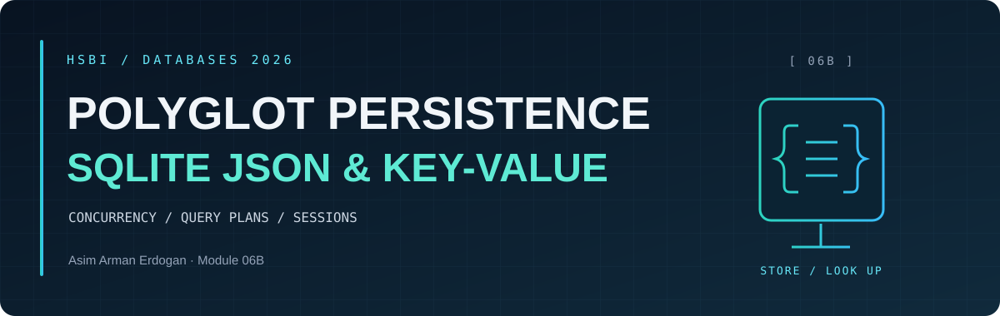

DATABASES 2026 &nbsp; / &nbsp; MODULE 06B &nbsp; / &nbsp; PROJECT

<h1 align="center">Project Ticket: <em>Surgical Simulator Training Review</em></h1>

<a href="README.md">Overview</a> &nbsp; · &nbsp; <a href="study-notes.md#task-3--kortmann-decision-record">Decision record</a>

A surgical skills instructor needs to decide which part of a simulator exercise a trainee should repeat. The first query asks: for a selected trainee and exercise, how many times did the tracked instrument tip leave the permitted area in each of the trainee's last five sessions, and how long did it stay outside? The database stores sessions, tracked positions and timestamped boundary-crossing events. A first version can generate reproducible synthetic trajectories with a fixed seed and known boundary crossings, then import timestamped coordinates from camera tracking on a benchtop simulator when that prototype is available.
