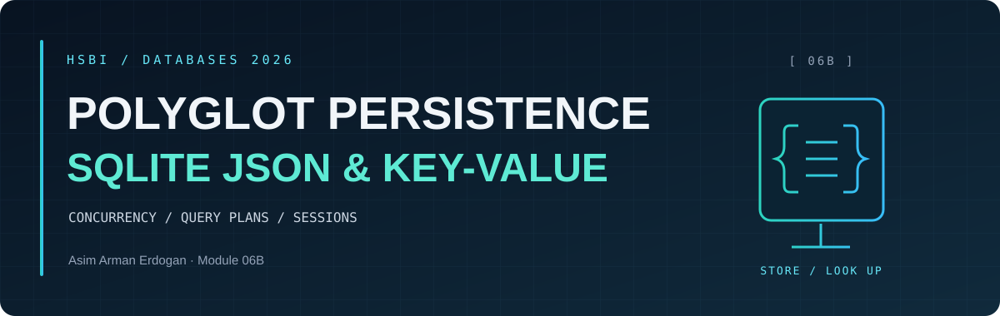

<p align="center"><sub>DATABASES 2026 &nbsp; / &nbsp; MODULE 06B &nbsp; / &nbsp; EVIDENCE</sub></p>
<h1 align="center">Polyglot Persistence: <em>Notes and Decision Record</em></h1>

<p align="center"><a href="README.md">Overview</a> &nbsp; · &nbsp; <a href="#task-1--local-and-remote-writes">Concurrency</a> &nbsp; · &nbsp; <a href="#task-2--vendor-json-and-session-keys">JSON and sessions</a> &nbsp; · &nbsp; <a href="#task-3--kortmann-decision-record">Decision record</a></p>

## Task 1 | Local and remote writes

[concurrency.py](concurrency.py) ran the SQLite fallback from the course. Connection A used `BEGIN IMMEDIATE` and incremented machine 1. With a zero-second busy timeout, connection B's competing increment returned `database is locked`. A committed, B retried, and the final count was **2**. This demonstrates writer contention between two connections to the same file. The supplied pod screenshot showed machine 1 at `guetersloh` with an initial count of 0 on the local console.

- **Easier on a server.** Clients on different devices can connect to one shared source of truth and issue the same atomic increment.
- **Harder on a server.** Clients depend on authentication, roles, a working network path and server operations.
- **Additional failure mode.** If the database server or route goes down, even clients with a working browser and valid SQL lose access. The PostgreSQL shutdown/restart is an instructor demonstration.

SQLite transactions give the local file ACID semantics. PostgreSQL can serialize updates to the same row while allowing unrelated writes to proceed. BASE describes systems that may serve temporarily stale state and converge later. CAP applies to replicated systems during a network partition, when an implementation must trade linearizable consistency against answering every request. Losing access to a single PostgreSQL primary is a reachability failure.

## Task 2 | Vendor JSON and session keys

[json_bench.py](json_bench.py) ran on SQLite 3.53.1 and rejected malformed data with `CHECK constraint failed: json_valid(meta)`. It loaded 1,000 devices.

| Device | Vendor extracted | Firmware extracted |
| --- | --- | --- |
| cnc-01 | Siemens | 4.2 |
| cnc-02 | Fanuc | 3.9 |
| molder-07 | Arburg | 8.1 |
| device-0004 | Fanuc | 4.4 |
| device-0005 | Arburg | 0.5 |

`json_each` expanded `cnc-01` into `calibrated = 2026-01-10`, `firmware = 4.2`, and `vendor = Siemens`. Both filters returned the same **334 names**.

| Vendor predicate | Observed plan |
| --- | --- |
| `json_extract(meta, '$.vendor') = 'Fanuc'` | `SEARCH device USING INDEX ix_device_vendor (<expr>=?)` |
| `meta ->> 'vendor' = 'Fanuc'` | `SCAN device` |

SQLite matches the indexed expression, so the shorthand produces the same result via a different plan. JSON accommodates optional vendor fields inside the relational record. The application still owns the types and meaning of each key. Session state uses a primary-key lookup with one value per key.

### Key-value homework

[kv_compare.py](kv_compare.py) verified all 20,000 values in both stores. Timings are one Windows run with Python 3.12.14 and SQLite 3.53.1. Writes include `shelve.sync()` or the SQLite commit. The SQLite write uses one transaction with `executemany`, so this compares the chosen access patterns and their write policies.

| Store | Set 20,000 | Get 20,000 |
| --- | ---: | ---: |
| Python shelve | 13.4312 s | 2.8640 s |
| SQLite | 0.0536 s | 2.9859 s |

Reads were close on this run. SQLite had substantially faster batched writes and supports SQL queries across sessions, for example counting how many sessions last selected a city filter. The measured result supports using SQLite for dashboard sessions and depends on the platform's shelve backend.

## Task 3 | Kortmann decision record

| Workload | Engine | Why and evidence | Cost accepted | If stale or missing |
| --- | --- | --- | --- | --- |
| Two-year month-end report | DuckDB over Parquet | The same 2,000,000-row report took 1,490.58 ms in SQLite and 45.76 ms in DuckDB (32.57×). The Snappy Parquet file was 2.32 MB. [6a measurements](../Module06a/duckdb-notes.md) | A validated nightly copy and a freshness indicator. | Show the last verified export timestamp. Rebuild before closing the month if the report is behind. |
| Machine/job ingest every 30 s | SQLite | The [Module 4 integrity lab](../Module04/) rejected invalid and duplicate data. The UPSERT kept four readings across two loads and applied the corrected value. | One writer at a time. Retry after contention and use short transactions. | Retain unacknowledged events in the producer and retry by event key. |
| Vendor metadata | SQLite JSON | Both predicates found 334 Fanuc devices. The expression index let the matching filter use a search instead of a scan. | Maintain an index for each frequently filtered path and validate key types in the application. | Missing optional fields appear as NULL. Flag missing calibration metadata for review. |
| Dashboard session state | SQLite key-value table | 20,000 sets took 0.0536 s vs 13.4312 s in shelve. Reads were in the same range. | Maintain a primary key and expire old sessions. | Recreate the session and use default filters. |
| Concurrent network users | PostgreSQL when direct shared access is required | The SQLite fallback gave `database is locked` for the second writer and reached 2 on retry. PostgreSQL's row-level behavior is a design expectation here. | Server operations, credentials and network dependency. | All clients can lose access during an outage. |

**With one engine, choose SQLite.** It protects the operational ingest and handles metadata and session queries. The month-end scan is the first workload likely to miss its latency target as history grows.

**Defence preparation.** Parquet duplicates historical job-part data and the nightly report job owns its refresh. Source writes remain in SQLite. An atomic increment and a bounded retry prevent a lock conflict from silently dropping a count. The dashboard session row was updated after the local benchmark to cite the four measured timings. The cross-pod defence and any change resulting from peer feedback are class activities.

## Reproduce

```sh
uv run --no-project python Module06b/concurrency.py
uv run --no-project python Module06b/json_bench.py
uv run --no-project python Module06b/kv_compare.py
```

[Project ticket](project-ticket.md) · [Reflection draft](../Reflections/ref06b.md) · [Course module](https://github.com/iotempire/iotempire-teaching/blob/main/full-classes/hsbi-databases-10d/modules/06b-polyglot-persistence.md)

Implementation and verification were prepared with AI assistance.
